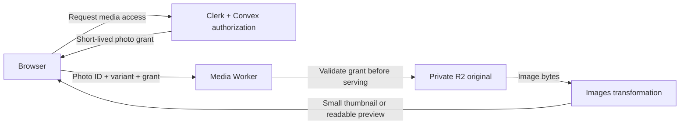

# Cloudflare R2 + Images: integration research

Researched: 2026-10-13. Scope: future integration for job-ticket photos in this Next.js/Vercel, Clerk, and Convex application. Research only: no application code, dependencies, Cloudflare resources, or production settings were changed. Examples below are illustrative and untested.

## Recommendation

Use **private R2 storage for the canonical photo, Cloudflare Images for resizing, and a small Cloudflare Worker for authorized delivery**. Keep the application on Vercel and the file metadata and tenant permissions in Convex. These products have complementary roles; using Images transformations does not require uploading another original into Images storage. Cloudflare explicitly documents this approach. [Cloudflare product guidance](https://developers.cloudflare.com/images/get-started/introduction/)

For this app, start with two bounded image variants: a thumbnail up to 160 × 160 pixels and a readable preview up to 2000 × 2000, preserving aspect ratio without cropping. Measure legibility and transferred bytes before choosing final quality. Public product or marketing images could instead use the simpler public R2 custom-domain URL pattern.

This recommendation assumes job-ticket photos should require tenant authorization. That is a proposed policy, not a claim that existing UploadThing URLs are private.

## Official examples worth starting with

| Reference                                                                                                                                                                                 | What it demonstrates                                     | How we would use it                                                                                            |
| ----------------------------------------------------------------------------------------------------------------------------------------------------------------------------------------- | -------------------------------------------------------- | -------------------------------------------------------------------------------------------------------------- |
| [R2 + Images reference architecture](https://developers.cloudflare.com/reference-architecture/diagrams/content-delivery/optimizing-image-delivery-with-cloudflare-image-resizing-and-r2/) | Originals in R2, transformed delivery through Cloudflare | Overall product split and public delivery model                                                                |
| [Transform user uploads before storing in R2](https://developers.cloudflare.com/images/tutorials/optimize-user-uploaded-image/)                                                           | A complete Worker tutorial with Images and R2 bindings   | A runnable starting point for optional upload-time normalization; its demo still needs our auth and validation |
| [Images binding API](https://developers.cloudflare.com/images/optimization/binding/)                                                                                                      | Read image bytes, transform, return an image response    | Private R2 delivery without exposing a source URL                                                              |
| [R2 signed uploads](https://developers.cloudflare.com/r2/api/s3/presigned-urls/)                                                                                                          | AWS SDK examples generating temporary PUT URLs           | Direct browser upload, with server-owned upload intents                                                        |
| [Convex R2 component and example app](https://github.com/get-convex/r2)                                                                                                                   | React upload hook, R2 access, metadata synchronization   | Evaluate as an integration helper; retain our tenant and file validation rules                                 |
| [Cloudflare's Next.js loader examples](https://developers.cloudflare.com/images/optimization/transformations/integrate-with-frameworks/)                                                  | Using Cloudflare as the image optimization service       | Optional frontend integration, rather than running a second optimizer                                          |

## Three integration patterns

### A. Public R2 originals + URL transformations

Attach a custom domain such as `media.example.com` to a bucket, enable image transformations on its Cloudflare zone, and request a resized URL:

```text
Original:
https://media.example.com/photos/example.jpg

Thumbnail:
https://media.example.com/cdn-cgi/image/width=160,fit=scale-down,format=auto/photos/example.jpg
```

Cloudflare fetches the original when needed, transforms it, and caches the result. Its reference architecture keeps only originals in R2. A production custom domain provides Cloudflare caching; `r2.dev` is intended for development and does not provide that equivalent production setup. [Architecture and URL syntax](https://developers.cloudflare.com/reference-architecture/diagrams/content-delivery/optimizing-image-delivery-with-cloudflare-image-resizing-and-r2/), [R2 public buckets](https://developers.cloudflare.com/r2/buckets/public-buckets/)

For custom routing, a Worker can use a URL fetch:

```js
// Illustrative Worker fragment; source URL must be trusted/allowlisted.
return fetch(sourceUrl, {
  cf: { image: { width: 160, height: 160, fit: "scale-down" } },
});
```

`cf.image` operates on a fetchable source URL. The Images binding below accepts bytes instead. URL-based Workers can also authenticate access to protected origins, but that is additional application logic. [Transform via fetch](https://developers.cloudflare.com/images/optimization/transformations/transform-via-workers/), [Control origin access](https://developers.cloudflare.com/images/optimization/transformations/control-origin-access/)

**Fit:** public content. An unprotected public bucket is unsuitable for tenant-private ticket photos. Restrict source origins and transformation options to avoid running an open transformation service for arbitrary URLs.

### B. Private R2 + Images binding — recommended

Keep the bucket's public endpoints disabled. The Worker reads the file through its R2 binding and supplies the stream directly to Images. No public R2 URL is needed. [Images binding](https://developers.cloudflare.com/images/optimization/binding/)



Illustrative Wrangler bindings, to be added to a complete Worker configuration later:

```jsonc
{
  "images": { "binding": "IMAGES" },
  "r2_buckets": [{ "binding": "PHOTOS", "bucket_name": "job-ticket-photos" }],
}
```

Illustrative rendering helper, **not a complete HTTP endpoint**. Its caller must validate the request/grant, resolve the permitted tenant-owned object, and reject unsupported variants before invoking it:

```ts
type PhotoVariant = "thumbnail" | "preview";

async function renderAuthorizedPhoto(
  env: { PHOTOS: R2Bucket; IMAGES: ImagesBinding },
  authorizedKey: string,
  variant: PhotoVariant,
) {
  const photo = await env.PHOTOS.get(authorizedKey);
  if (!photo) return new Response("Not found", { status: 404 });

  const edge = variant === "thumbnail" ? 160 : 2000;
  const rendered = await env.IMAGES.input(photo.body)
    .transform({ width: edge, height: edge, fit: "scale-down" })
    .output({ format: "image/webp", quality: 85 });

  return rendered.response({
    headers: { "Cache-Control": "private, no-store" },
  });
}
```

The binding and response methods above are documented APIs; Worker types come from the Cloudflare toolchain. This helper starts without shared response caching to make the authorization boundary clear. [Binding methods](https://developers.cloudflare.com/images/optimization/binding/)

Recommended delivery contract: grant issuance checks Clerk identity and Convex tenant/warehouse access; the Worker validates a server-issued, expiring grant scoped to photo, tenant, object version, and allowed variants. A bearer URL can be shared until expiry. If immediate revocation is required, check current authorization on each request instead of relying solely on an expiring grant.

Do not assume an `` request can carry a custom Authorization header. Choose signed URLs, suitable same-site cookies, or an authenticated fetch-to-Blob approach explicitly. Do not store expiring URLs as permanent Convex data; store the object key/file ID and generate delivery access when needed.

### C. Cloudflare Images hosted storage

Images can also store originals itself and provide direct creator uploads, predefined variants, and delivery. Its one-time upload URL keeps the account API token on the server. In that design, R2 is optional; copying every original to both products adds storage and lifecycle work unless it is a deliberate archive. [Hosted workflow](https://developers.cloudflare.com/images/get-started/introduction/), [Direct Creator Upload](https://developers.cloudflare.com/images/storage/upload-images/direct-creator-upload/)

Hosted private images support expiring signed delivery URLs. Audit variants carefully: a variant configured for always-public access can bypass the image's signed-URL requirement. [Private hosted images](https://developers.cloudflare.com/images/optimization/hosted-images/serve-private-images/)

**Fit:** choose this if managed uploads and delivery matter more than maintaining a general file store. R2 + transformations fits our stated direction and can also store future non-image attachments.

## Direct uploads and trustworthy finalization

Proposed application flow:

1. Authenticate the user and verify the target tenant/warehouse. Create a pending upload intent with a server-generated random key, accepted types, expected size, owner, expiry, and intended scan association.
2. Issue a short-lived signed PUT URL for that pending object. Keep bucket credentials server-side.
3. Browser uploads directly to R2; only control requests and metadata pass through Vercel/Convex.
4. A finalization request rechecks identity, ownership, and intent. Read stored metadata and validate actual bytes/decodability, size, dimensions, and format before marking the file ready.
5. Associate the validated immutable object with the scan idempotently. Expire abandoned pending uploads and reconcile failures.

Illustrative signing core, after application authorization and intent creation:

```ts
// S3 is a server-side S3Client using R2's endpoint and region "auto".
// pendingKey and acceptedType come from a validated upload intent.
const uploadUrl = await getSignedUrl(
  S3,
  new PutObjectCommand({
    Bucket: bucketName,
    Key: pendingKey,
    ContentType: acceptedType,
  }),
  { expiresIn: 300 },
);
```

Cloudflare documents `@aws-sdk/client-s3` and `@aws-sdk/s3-request-presigner` for this. The matching Content-Type header is signed, but a declared MIME type is not proof of file contents. Presigned URLs can be reused until expiry and use the R2 S3 endpoint, not a custom domain. [Presigned URL semantics and SDK example](https://developers.cloudflare.com/r2/api/s3/presigned-urls/)

Because the uploader can reuse the pending URL, finalization must prevent later replacement of accepted bytes. Proposed solution: validate the pending object and conditionally copy the verified object version to a new final key the browser cannot write. Use an ETag/precondition during the promotion so a concurrent overwrite cannot swap the bytes after validation. Exact copy/precondition support must be confirmed during implementation.

Configure bucket CORS for the explicit production and approved development origins, PUT, and the headers the client actually sends. CORS is required for browser uploads; it does not replace authorization. Avoid wildcard origins for this app. [R2 CORS](https://developers.cloudflare.com/r2/buckets/cors/)

### Convex component opportunity and limitation

`@convex-dev/r2` provides upload hooks plus read/upload/delete permission callbacks and metadata helpers. Its included example is a useful starting point. [Official repository](https://github.com/get-convex/r2)

The source inspected on this date has two material details: `generateUploadUrl()` signs Bucket/Key without our application type/size rules, and `clientApi().syncMetadata` calls `onUpload` before scheduling the metadata-sync action. Therefore, `onUpload` or a completed browser hook is not evidence that server validation finished. Keep upload-intent ownership, validation, and finalization explicit; evaluate `onSyncMetadata` only as one input to that process. Its default download URL expires after 900 seconds. [Component source](https://raw.githubusercontent.com/get-convex/r2/main/src/client/index.ts)

## Cost model and the recent billing change

Prices are USD before tax, checked on 2026-10-13; recheck at implementation.

| Product meter          | Published allowance/rate                              |
| ---------------------- | ----------------------------------------------------- |
| R2 Standard storage    | 10 GB-month free; then $0.015/GB-month                |
| R2 Class A operations  | 1 million/month free; then $4.50/million              |
| R2 Class B operations  | 10 million/month free; then $0.36/million             |
| R2 internet egress     | No R2 egress charge                                   |
| Images transformations | 5,000 unique/month included; then $0.50/1,000 on Paid |
| Images hosted storage  | $5 per 100,000-image storage increment/month          |
| Hosted Images delivery | $1/100,000 qualifying deliveries                      |

R2 rounds usage upward to its billing units, including whole GB-month and million-operation units; allowances above are for Standard, not Infrequent Access. [R2 pricing](https://developers.cloudflare.com/r2/pricing/)

For R2 originals, use the transformation meter, not hosted Images storage/delivery. A unique transformation is a source image plus parameters requested within a calendar month. Repeat identical transformations that month count once; `format=auto` does not multiply billing for its negotiated formats. The Free plan stops new transformations beyond its allowance rather than charging overages. [Images pricing](https://developers.cloudflare.com/images/pricing/)

**Old advice that every Images binding call is separately billed is outdated.** Cloudflare changed the binding to unique-transformation billing on July 1, 2026; `.info()` is now free. This does not make repeated uncached decoding free of latency. [Official billing-change announcement](https://developers.cloudflare.com/changelog/post/2026-07-01-binding-unique-transformations/)

Workers remains a separate meter. Paid starts at $5/month with 10 million requests and 30 million CPU milliseconds included; extra requests are $0.30/million and CPU is $0.02/million milliseconds. Free has daily/runtime limits, so the estimates below budget Paid for production. [Workers pricing](https://developers.cloudflare.com/workers/platform/pricing/)

### Illustrative monthly scenarios

Assumptions: steady storage throughout the month; average 5 MB canonical photo; two requested variants per viewed photo; all relevant account allowances still available; no hosted Images storage. These are modeled workloads, not measurements of this app.

| Workload              | R2 storage | Viewed photos × variants | R2 storage cost | Images cost | Subtotal   | With $5 Worker plan |
| --------------------- | ---------- | ------------------------ | --------------- | ----------- | ---------- | ------------------- |
| 5,000 stored photos   | 25 GB      | 1,500 × 2 = 3,000        | $0.23           | $0.00       | **$0.23**  | **$5.23**           |
| 20,000 stored photos  | 100 GB     | 5,000 × 2 = 10,000       | $1.35           | $2.50       | **$3.85**  | **$8.85**           |
| 200,000 stored photos | 1,000 GB   | 50,000 × 2 = 100,000     | $14.85          | $47.50      | **$62.35** | **$67.35**          |

Calculated using the published [R2 rates](https://developers.cloudflare.com/r2/pricing/) and [Images rates](https://developers.cloudflare.com/images/pricing/). Monetary presentation rounds to cents; 25 GB costs $0.225 before rounding. The other rows use whole billing units. Assume each scenario remains below the R2 operation allowances and below 1 million Worker requests at 5 ms mean CPU, so no extra operation/Worker fees apply.

Excluded: existing Vercel/Convex/Clerk costs, independent backups, migration traffic charged by the old provider, and optional processing services. If the account already pays for Workers with sufficient capacity, its incremental subscription cost may be zero. A completely uncached private flow still incurs Worker requests and R2 reads on each display even when the transformation meter deduplicates.

Hosted comparison: 20,000 photos plus 1 million qualifying monthly deliveries would be $5 storage + $10 delivery = **$15/month** for those two meters, without R2. Qualifying deliveries return HTTP 200 and exceed 1,024 bytes under the October 12 pricing clarification. [Hosted Images pricing](https://developers.cloudflare.com/images/pricing/)

**R2 + transformations is not always the cheapest option.** For 100,000 originals averaging 1 MB, all requested in two variants during a month, the same formulas give $1.35 R2 storage + $97.50 transformations = **$98.85 before Workers**. Hosted Images with that image count and 1 million qualifying deliveries is **$15**. This is our calculation from the above rates: many unique photos/variants with relatively few repeat views can favor hosted Images. Measure active variants and deliveries as well as total stored GB before committing to a cost claim.

## Privacy, caching, formats, and recovery

### Cache after authorization

The current Images binding does not automatically cache its responses. Its docs recommend Workers Cache for performance, but that cache can respond **before Worker code runs**. Blindly enabling it in front of the grant/tenant check could serve a cached photo after a grant expires. [Images binding caching](https://developers.cloudflare.com/images/optimization/binding/), [Workers Cache configuration](https://developers.cloudflare.com/workers/cache/configuration/)

Start with `private, no-store` responses. Later, put an uncached authorization entrypoint in front of a private cached renderer, or perform an explicit cache lookup only after authorization. Cloudflare documents an outer-auth/inner-cache pattern. Include tenant, immutable object version, variant, and negotiated output format in the renderer cache identity; apply private browser policy to the outer response. Test warm-cache access after expiry, logout, revocation, and tenant changes. [Authenticated cache example](https://developers.cloudflare.com/workers/cache/examples/)

Limit transformations to named variants. Do not let callers vary arbitrary dimensions, quality, source URL, or watermarks. These constraints simplify predictable costs and preserve ticket readability.

**Alternative to evaluate:** because this screen needs only two sizes, generate them once after upload with Images and save the derivative files back into private R2, retaining the canonical original. Later views read those bytes through the authorized Worker without invoking transformations again. This trades extra storage/writes and version/deletion lifecycle work for lower repeated processing and recurring transformation usage. Cloudflare's [upload-transform-store tutorial](https://developers.cloudflare.com/images/tutorials/optimize-user-uploaded-image/) demonstrates the underlying operation. This is a proposal, not an implemented optimization.

### Mobile photo support

Current limits differ by path: remote URL images up to 100 MB; Images binding input up to 20 MB; hosted Images uploads up to 10 MB. HEIC is now listed as a supported input; AVIF input has an Enterprise restriction. Large pixel dimensions and animated image limits also apply. [Current formats and limits](https://developers.cloudflare.com/images/get-started/limits/)

Our 16 MB UploadThing ceiling fits the binding's byte limit but exceeds hosted Images' upload ceiling. Retain explicit application limits and reject excessive pixel counts. Test real iPhone HEIC photos, orientation, and fine printed text. The existing browser resize can return the original file when conversion fails, so do not assume every upload or AI input is JPEG. Decide whether to normalize server-side before extraction as a separate change.

### Recovery remains separate

R2's durability protects against infrastructure failures; it does not undo accidental or authorized deletion. Bucket locks can prevent overwrite/deletion for a retention period, but they need deliberate configuration. [R2 durability](https://developers.cloudflare.com/r2/reference/durability/), [Bucket locks](https://developers.cloudflare.com/r2/buckets/bucket-locks/)

Moving photos to R2 will not make Convex snapshots include their bytes. The [current recovery runbook](../operations/release-runbook.md#external-file-store) already identifies this gap. Define an independent copy/retention process, a manifest mapping Convex records to object versions, and a tested restore procedure. A cache is not that backup.

## How this maps to the current code

This is a snapshot of the worktree, which contains unrelated in-progress changes.

| Current integration                                                                                                                                                                                                      | Future change to evaluate                                                                           |
| ------------------------------------------------------------------------------------------------------------------------------------------------------------------------------------------------------------------------ | --------------------------------------------------------------------------------------------------- |
| [Upload route](../../src/app/api/uploadthing/core.ts): Clerk identity check, one image up to 16 MB                                                                                                                       | Tenant-aware upload intent, presigning, and trusted finalization                                    |
| [Resize helper](../../src/features/finishedGoods/jobScan/resizeImage.ts): longest side 2000, JPEG quality 0.85, original-file fallback                                                                                   | Preserve good client-side bandwidth reduction; verify format fallback and original-retention policy |
| [Scan screen](../../src/features/finishedGoods/jobScan/JobScanScreen.tsx): upload and AI extraction run in parallel                                                                                                      | Replace only upload/storage plumbing initially; keep AI data-URL processing independent             |
| [Scan schema](../../convex/schema.ts): optional `imageUrl` in tenant-scoped scan data                                                                                                                                    | Add stable provider/object metadata and file state; retain legacy URL while migrating               |
| [Photo preview](../../src/features/finishedGoods/jobScan/JobScanPhotoPreview.tsx) and [record row](../../src/features/finishedGoods/jobScan/JobScanRecordRow.tsx): same source for 44×64/56×80 thumbnail and full dialog | Separate thumbnail and readable-preview URLs; fetch the full preview only when needed               |
| [Security headers](../../src/lib/securityHeaders.ts): image restrictions currently report-only                                                                                                                           | Include the chosen media origin before enforcing that CSP; verify upload `connect-src` too          |

The small row thumbnail currently uses the same uploaded image as the full preview. Serving a bounded thumbnail is the clearest app-specific efficiency improvement; actual savings require measuring typical photo size.

The installed Next.js guides were read before making framework recommendations: `node_modules/next/dist/docs/01-app/01-getting-started/12-images.md`, `15-route-handlers.md`, and `03-api-reference/02-components/image.md`. The local Image reference says the default optimizer does not forward authentication headers. Keep native image delivery initially, or use `unoptimized`/a deliberate custom loader; do not accidentally proxy already-transformed private photos through another optimizer. Cloudflare supplies [Next.js loader examples](https://developers.cloudflare.com/images/optimization/transformations/integrate-with-frameworks/).

## Future migration sequence

1. **Decide policy and measure:** confirm private access, retention, canonical image definition, actual volume, and preview quality. Recheck prices and account prerequisites.
2. **Build an isolated vertical slice:** private development bucket, Worker, upload intent/finalization, and two variants. Test a real phone upload through authorized display, including invalid files and cross-tenant denial.
3. **Add a provider-aware file model:** stable file IDs/keys and explicit pending/ready states; read old UploadThing URLs and new R2 files during transition. Do not store signed URLs permanently.
4. **Switch new uploads behind a feature flag:** keep extraction behavior unchanged, collect upload/transform error rates and byte/latency measurements, and retain rollback.
5. **Backfill existing bytes:** identify the actual production UploadThing app first, inventory references, copy with bounded concurrency, verify hashes/size and a manifest, then update records idempotently. Keep old files until validation and the rollback period complete.
6. **Complete operations:** backup and restore drill, orphan cleanup, deletion/revocation behavior, credential rotation, monitoring, and retirement of UploadThing only after reconciliation.

Nothing in this sequence has been executed as part of this research.

## Decisions to settle before implementation

- Are all ticket photos private? Is short-lived bearer access acceptable, or must permission revocation take effect immediately?
- Does “original” mean the existing normalized 2000-pixel upload or the untouched camera file? The latter changes storage, privacy, and processing needs.
- Which backend owns upload intents and signing: Convex (preferred to keep permissions together) or a small Next.js route? Evaluate the Convex component against validation requirements before choosing.
- Which media domain and grant mechanism should work across production, previews, and local development?
- Are two variants sufficient, and what preview quality preserves small printed text on actual devices?
- What retention, independent backup location, recovery time, and deletion rules apply?
- The upload-transform tutorial explicitly requests an Images Paid subscription for the binding, while general pricing advertises free transformations. Confirm binding activation and any account-specific checkout minimum; do not promise a zero-dollar binding setup from the generic free-tier page alone. [Tutorial prerequisites](https://developers.cloudflare.com/images/tutorials/optimize-user-uploaded-image/)

The evidence supports this future architecture. It does not establish the account's current storage volume, production Cloudflare configuration, private-access policy, or measured performance; those remain implementation inputs.
