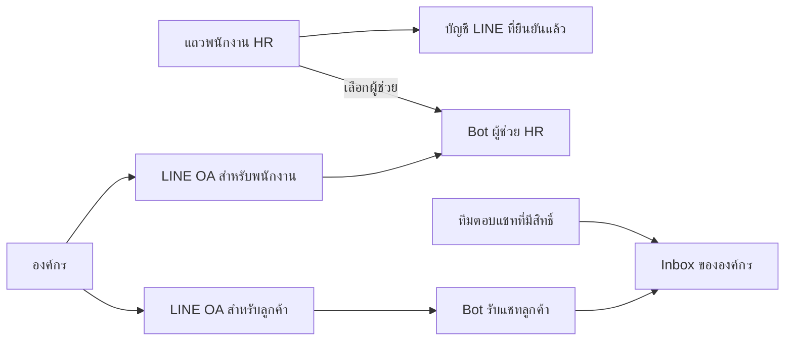

# แผนเบื้องต้น: LINE สำหรับธุรกิจ พนักงาน HR และแชทลูกค้า

วันที่ตรวจ: 13 ตุลาคม 2026 · สถานะ: ร่างเพื่อพิจารณา ยังไม่ใช่ข้อกำหนดที่อนุมัติให้ implement

โจทย์ที่ยืนยันแล้ว: “แต่ละ row” หมายถึง **แถวพนักงานใน HR** แต่ละแถวควรเริ่มเชื่อม LINE และ assign **bot ผู้ช่วย HR/แจ้งเตือน** ได้ การ assign นี้ไม่ใช่มอบหมายพนักงานให้ตอบแชทลูกค้า ธุรกิจตั้งค่าช่องทางเองได้ตั้งแต่ onboarding จนถึงตอบแชท กระบวนการลูกค้ายังไม่ชัด จึงเสนอเฉพาะโครงสร้างและ flow พื้นฐานก่อน

หลักฐาน EasePOS และข้อจำกัด LINE: [บันทึกการตรวจ](../references/easepos-line-integration-evidence-2026-10-13.md) ข้อเสนอด้านล่างเป็นการออกแบบสำหรับ Industrial SAS ไม่ใช่คำกล่าวว่าระบบมีฟีเจอร์เหล่านี้แล้ว

## 1. ข้อเสนอหลัก

แยกสามเรื่องที่ผู้ใช้เห็นเป็นงานคนละอย่าง:

1. **ธุรกิจเชื่อม LINE OA**: ช่องทางที่รับและส่งข้อความ ใครเป็นเจ้าของ ใช้กับพนักงานหรือลูกค้า และตรวจว่าพร้อมใช้งาน
2. **พนักงานเชื่อม LINE ส่วนตัว**: ยืนยันว่าบัญชี LINE นี้เป็นของพนักงานในแถว HR นั้น สำหรับ bot ผู้ช่วย/แจ้งเตือน ไม่ใช่สร้าง LINE OA ใหม่ให้ทุกคน
3. **Assign bot ผู้ช่วย HR**: เลือก bot ที่ช่วยและแจ้งเตือนพนักงานคนนั้นจากแถว HR ส่วนผู้รับผิดชอบแชทลูกค้าจัดการใน inbox/ทีมตอบแชท

ผู้ใช้ยืนยันว่า assign bot หมายถึงผู้ช่วย HR และการแจ้งเตือน การเชื่อม LINE และเลือกผู้ช่วยไม่ให้สิทธิ์ HR/admin หรือสิทธิ์อ่านแชทลูกค้าโดยอัตโนมัติ

ข้อเสนอเริ่มต้น: รองรับประเภทช่องทาง `พนักงาน` และ `ลูกค้า` โดยแนะนำแยก OA ถ้ามีทั้งสองงาน หากธุรกิจต้องการใช้ OA เดียว ต้องกำหนดการแยก audience และเส้นทางตอบให้ชัดก่อนเปิดใช้ ไม่จำเป็นต้องมี OA ต่อพนักงานหนึ่งคน

## 2. สิ่งที่นำจาก EasePOS และ baseline ของ Industrial SAS

จาก source EasePOS ที่ pin ไว้ใน [บันทึกหลักฐาน](../references/easepos-line-integration-evidence-2026-10-13.md):

- มี wizard และ readiness stepper ที่อิงหลักฐานฝั่ง server: credentials, signed webhook, ความพร้อม link identity และทดสอบ ไม่ถือว่าการ save form คือเชื่อมครบ
- มีการเชื่อม LINE แบบ QR/ลิงก์ในแถวลูกค้า เป็น pattern ที่นำมาใช้กับแถวพนักงาน HR ของเราได้ แต่ไม่ใช่หลักฐานว่า EasePOS มี HR bot assignment แบบโจทย์นี้แล้ว
- หน้าตั้งค่ากรอก channel access token/secret และ LINE Login/LIFF ตามขั้นจริง เป็น guided self-service; เราเสนอ Messaging API account linking เป็น MVP ของพนักงานเพื่อไม่บังคับตั้ง LIFF ก่อนเชื่อม
- EasePOS แยก OA ลูกค้าที่ร้านเป็นเจ้าของกับ OA แจ้งเตือนพนักงานที่ Ease เป็นเจ้าของ แผนนี้เสนอให้ธุรกิจเป็นเจ้าของช่องทางตนเองก่อน หากต้องการ OA HR ร่วมของแพลตฟอร์ม ให้ตัดสินใจเรื่อง tenant routing และ ownership แยกต่างหาก

ตรวจจาก working tree ปัจจุบัน ซึ่งมีงานอื่นกำลังเปลี่ยนอยู่ ไม่ถือเป็นผลยืนยัน deployment:

| จุดที่มีอยู่                                                       | หลักฐาน                                                                                                                                         | ผลต่อแผน                                                                      |
| ------------------------------------------------------------------ | ----------------------------------------------------------------------------------------------------------------------------------------------- | ----------------------------------------------------------------------------- |
| พนักงานมีองค์กร ไซต์ สถานะ บัญชีสมาชิก และหัวหน้างาน               | [schema](../../convex/schema.ts), [HR setup](../../convex/hr/setup.ts)                                                                          | ใช้ `hrEmployees` เป็นทะเบียนพนักงานหลัก ไม่สร้างทะเบียนเจ้าหน้าที่อีกชุด     |
| หน้ารายชื่อมีตาราง desktop และการ์ด mobile; เปิด editor ด้วย query | [EmployeesScreen](../../src/features/hr/EmployeesScreen.tsx)                                                                                    | เพิ่มสถานะ/ปุ่ม LINE ในทั้งสองรูปแบบ พร้อมรักษา origin และ draft ของ editor   |
| HR admin และ self-service มีขอบเขตสิทธิ์จริงฝั่ง server            | [permissions](../../convex/lib/permissions.ts), [HR shared](../../convex/hr/shared.ts), [tenant functions](../../convex/lib/tenantFunctions.ts) | LINE adapter ต้องตรวจสิทธิ์เหล่านี้ ไม่เชื่อ `employeeId` หรือ `orgId` จากแชท |
| Profile พนักงานและ HR Settings มีอยู่แล้ว                          | [ProfileScreen](../../src/features/hr/ProfileScreen.tsx), [SettingsScreen](../../src/features/hr/SettingsScreen.tsx)                            | ใช้เป็นจุดเชื่อมด้วยตัวเองและทางเข้าตั้งค่าระดับธุรกิจ                        |
| HTTP router ปัจจุบันมี webhook Clerk                               | [convex/http.ts](../../convex/http.ts)                                                                                                          | ยังไม่มี webhook LINE ใช้งานจริง                                              |
| มีชื่อ LINE ใน validators และแผน integration เดิม                  | [validators](../../convex/lib/validators.ts), [แผน T12–T13](bun-elysia-delivery-plan-2026-10-11.md)                                             | เป็นแนวเตรียมการ ไม่ใช่ connector, bot หรือ inbox ที่ส่งมอบแล้ว               |

ยังไม่พบ LINE identity, channel connection, bot assignment หรือ chat inbox ใน schema/routes ปัจจุบัน และยังไม่พบทะเบียนตัวตนลูกค้าที่ควรใช้ผูก LINE โดยตรง ข้อมูล `customer`/`customerReference` ในงานผลิตยังไม่เพียงพอสำหรับยืนยันบัญชีลูกค้า

## 3. Flow ธุรกิจ onboard ด้วยตัวเอง

ทางเข้าเสนอ: **ตั้งค่า → การเชื่อมต่อ → LINE** และลิงก์จาก HR Settings เมื่อยังไม่มีช่องทางพนักงาน เส้นทางจริงต้องสรุปกับ navigation inventory ตอน implement

| ขั้น              | สิ่งที่เจ้าของธุรกิจทำ                              | ระบบต้องช่วย/ตรวจ                                                                                                    |
| ----------------- | --------------------------------------------------- | -------------------------------------------------------------------------------------------------------------------- |
| 1. เลือกการใช้งาน | พนักงาน / ลูกค้า; มี OA แล้ว / ยังไม่มี             | อธิบายว่าแต่ละช่องทางรับข้อมูลและข้อความแบบไหน                                                                       |
| 2. เตรียม LINE OA | เปิด OA Manager และเปิด Messaging API               | คู่มือภาษาไทย ลิงก์ตรง checklist และบันทึกความคืบหน้า; การเลือก provider ต้องระวังเพราะย้ายไม่ได้                    |
| 3. เชื่อมช่องทาง  | กรอกข้อมูล channel/credentials ตามคู่มือ            | ตรวจ token กับ bot/channel ตัวจริง แสดงชื่อและรูป OA ให้ยืนยัน เก็บ credentials ฝั่ง server และไม่ส่งกลับให้ browser |
| 4. เปิดรับข้อความ | คัดลอก webhook URL ไปตั้งใน LINE และเปิด webhook    | ตรวจ URL เดิมก่อนเปลี่ยน หาก OA ใช้ระบบอื่นอยู่ต้องเลือกว่าจะย้ายหรือใช้ตัวกลาง ห้ามเขียนทับเงียบ ๆ                  |
| 5. ตั้ง bot/ทีม   | เลือก bot เริ่มต้น พนักงานที่รับผิดชอบ และ fallback | ให้เริ่มด้วยคนตอบหรือ bot แบบกฎ/FAQ; การตอบอัตโนมัติเป็นตัวเลือกที่ต้องเปิดอย่างชัดเจน                               |
| 6. ทดสอบ          | เพิ่มเพื่อน OA ส่งข้อความทดสอบ และรับคำตอบ          | ตรวจ inbound จริง → การตอบจาก bot/คน → ข้อความถึง LINE; credential ผ่านอย่างเดียวไม่ใช่พร้อมใช้งาน                   |
| 7. เปิดใช้        | กดเปิดหลัง checklist ผ่าน                           | แสดงสถานะ ช่องทาง ทีมผู้ดูแล และเส้นทางแก้ปัญหา; กลับมาทำต่อภายหลังได้                                               |

Self-onboarding รอบแรกเป็น **guided setup** ที่ทำเองได้โดยมีการตรวจช่วย ไม่สัญญาว่ากด LINE Login ครั้งเดียวแล้วระบบสร้าง/เชื่อม OA ทุกอย่างได้ ขั้นสร้าง OA และเปิด Messaging API อยู่ในเครื่องมือ LINE ตาม [เอกสารเริ่มต้น](https://developers.line.biz/en/docs/messaging-api/getting-started/)

ต้องแยกสถานะ `ยังตั้งค่าไม่ครบ`, `credentials ผ่าน`, `webhook ผ่าน`, `ทดสอบรับส่งผ่าน`, `เปิดใช้งาน`, `ต้องแก้ไข`, `พักใช้งาน` หน้า error บอกขั้นที่ผิดและปุ่มแก้ตรงจุด ไม่แสดง “เชื่อมต่อสำเร็จ” เมื่อบันทึกค่าลงฐานข้อมูลอย่างเดียว

## 4. เชื่อม LINE จากแถวพนักงาน HR

Desktop เพิ่มส่วน **LINE** และ **Bot** ในแถวเดิม; mobile เพิ่มรายการและปุ่มใน employee card ใช้ปุ่มมีชื่อชัดเจน ไม่เปลี่ยนทั้งแถวเป็น click target ที่ซ้อนปุ่มอื่น

ตัวอย่างข้อมูลสมมติ:

| พนักงาน             | บัญชีสมาชิก | LINE         | Bot        | การกระทำ                    |
| ------------------- | ----------- | ------------ | ---------- | --------------------------- |
| EMP-001 · พนักงาน A | เชื่อมแล้ว  | ยังไม่เชื่อม | ผู้ช่วย HR | เชื่อม LINE · เปลี่ยน bot   |
| EMP-002 · พนักงาน B | เชื่อมแล้ว  | รอยืนยัน     | ผู้ช่วย HR | ดู QR/ลิงก์ · ยกเลิกคำเชิญ  |
| EMP-003 · พนักงาน C | เชื่อมแล้ว  | เชื่อมแล้ว   | ผู้ช่วย HR | ดูการเชื่อมต่อ · จัดการ bot |

Flow ที่เสนอ:

1. HR กด **เชื่อม LINE** ในแถว ระบบตรวจสิทธิ์ ไซต์ พนักงาน active และบัญชีสมาชิกก่อน ถ้ายังไม่มีบัญชีสมาชิก แนะนำเชื่อมสมาชิกก่อน รอบแรกยังไม่เปิดการ claim ด้วยรหัสพนักงานอย่างเดียว
2. เปิด Sheet ที่ระบุพนักงาน องค์กร OA เป้าหมาย และ QR/คำแนะนำให้เริ่มเชื่อมผ่าน OA คำเชิญใช้ครั้งเดียวและหมดอายุ QR มีหน้าที่เริ่ม flow ไม่ใช่หลักฐานยืนยันตัวตน
3. พนักงานเพิ่มเพื่อน OA และเลือกเชื่อมบัญชี Bot เริ่ม [Messaging API account linking](https://developers.line.biz/en/docs/messaging-api/linking-accounts/): ส่ง linking URL → พนักงาน login บัญชีระบบของตัวเอง → server resolve พนักงานที่ผูกจริง → ตรวจว่าเป็นผู้รับคำเชิญ → สร้าง nonce → LINE ยืนยันผ่าน signed account-link webhook
4. บันทึก binding เมื่อผลสำเร็จและ nonce ถูกต้องเท่านั้น จากนั้นแถว HR แสดงสถานะเชื่อมแล้ว ชื่อ LINE เป็นข้อมูลแสดงผล ไม่ใช้ชื่อ/เบอร์โทรตัดสินว่าเป็นคนเดียวกัน
5. พนักงานเริ่ม flow เดียวกันจาก **HR → โปรไฟล์ของฉัน → เชื่อม LINE** และยกเลิกการเชื่อมเองได้ HR เห็นสถานะและระงับ binding ได้ตามสิทธิ์

HR ที่ login อยู่บนคอมพิวเตอร์ต้องไม่สามารถเชื่อม LINE ของตนเป็นบัญชีพนักงานคนอื่นโดยแค่กดปุ่มบนแถวนั้น ข้อผิดพลาดสำคัญ: คำเชิญหมดอายุ, replay, บัญชีระบบผิดคน, LINE เคยเชื่อมคนอื่น, provider ผิด, พนักงานถูกปิดสถานะระหว่างเชื่อม

LINE Login/LIFF อาจช่วยเปิดหน้าพนักงานใน LINE ภายหลัง แต่ไม่จำเป็นสำหรับ account linking รอบแรก และไม่ถือเป็นสิทธิ์เข้า HR โดยอัตโนมัติ

## 5. Assign bot ผู้ช่วย HR และแจ้งเตือน

| ความสัมพันธ์           | ความหมาย                                | ตัวเลือกเริ่มต้น                                                                     |
| ---------------------- | --------------------------------------- | ------------------------------------------------------------------------------------ |
| พนักงาน → bot ผู้ช่วย  | Bot ที่พนักงานคุยด้วยเพื่อช่วยเรื่อง HR | เลือก bot HR ที่เปิดใช้และเข้าถึงได้ในไซต์นั้น; อาจมี default ขององค์กร              |
| พนักงาน → การแจ้งเตือน | การแจ้งเตือนส่วนตัวผ่าน OA ที่เชื่อม    | ตั้งประเภท เวลา quiet hours และเปิด/ปิดตามนโยบายขององค์กร; ไม่ส่งข้อมูล HR ของคนอื่น |

หนึ่ง bot/LINE channel ดูแลพนักงานได้หลายคน การเลือก bot ที่แถวเป็นการเลือก configuration ผู้ช่วย ไม่ใช่ออก channel access token ให้พนักงานแต่ละคน เริ่มด้วยผู้ช่วยหลักหนึ่งตัวต่อพนักงาน พร้อม default ขององค์กร ลดกรณีหลาย bot ตอบเรื่องเดียวกัน

เปลี่ยน bot profile ใน OA เดิมใช้ binding เดิมได้เมื่อ scope ผ่าน แต่ถ้าเปลี่ยนไป OA/connection ใหม่ ต้องตรวจ binding ของช่องทางเป้าหมายและให้เชื่อมใหม่เมื่อยังไม่ยืนยัน ห้ามคัดลอก LINE user ID ไปอีก provider แล้วแสดงว่าเชื่อมสำเร็จ

Bot HR รอบแรกควรช่วยเรื่องข้อมูลพื้นฐาน ตารางงานของตน และลิงก์ไปงาน HR ที่มีจริง เช่น ตรวจเวลา/คำขอแก้ไข ยังไม่เปิดให้ AI แก้เวลา อนุมัติคำขอ หรืออ่านเงินเดือนผ่านข้อความอิสระ การแจ้งเตือนส่งเท่าที่จำเป็น และลิงก์กลับเข้าแอปที่ตรวจสิทธิ์อีกครั้ง

ตัวอย่างแจ้งเตือนที่เสนอ: ผลตรวจคำขอแก้ไขเวลา, เตือนลงเวลาเมื่อเข้าเงื่อนไขที่ตกลง, และข้อมูลวันหยุดที่เกี่ยวกับไซต์ตนเอง ตั้ง frequency/quiet hours และ dedup ต่อเหตุการณ์ พนักงานปรับการรับแจ้งเตือนได้ หากถูกบล็อกหรือ unlink ให้แสดงส่งถึงไม่ได้และหยุด retry ที่ไม่เกิดประโยชน์ ประกาศบริษัท/ใบลา/สลิปเงินเดือนต้องรอ module และ policy ที่ส่งมอบจริง ไม่แสดงเป็นข้อมูลที่ bot อ่านได้แล้ว

หน้า Settings ควรแสดงการใช้ quota ส่งข้อความและปัญหาการแจ้งเตือน กำหนดเพดาน/ลำดับความสำคัญของระบบเองด้วย เมื่อ quota หมดให้แสดง pending/failed ตามผลจริง และมีข้อมูลในแอปให้พนักงานอ่าน ไม่แสดงว่า LINE แจ้งแล้วโดยไม่มีหลักฐาน

Bot ลูกค้าเริ่มด้วยข้อความต้อนรับ FAQ ที่ธุรกิจตั้งไว้ และส่งต่อคนเมื่อไม่แน่ใจ หากใช้ AI ให้เริ่มด้วยคำตอบร่างและแหล่งข้อมูลที่องค์กรอนุญาต ไม่สมมติว่าระบบค้นหา AI ที่มีอยู่เป็น chatbot พร้อมใช้งาน

เมื่อพนักงานออกจากงาน/สมาชิกถูก revoke ให้หยุด HR self-service/การแจ้งเตือนและสิทธิ์ตอบแชททันที ย้ายงานค้างไปทีมสำรอง เก็บประวัติผู้ตอบเดิมไว้ การพัก bot หรือ channel ต้องมี fallback และเห็นสถานะในแถว

## 6. หน้าตอบแชท

เสนอพื้นที่ **ข้อความ → LINE** เป็น inbox ขององค์กร แยกมุมมองลูกค้ากับพนักงานด้วยสิทธิ์ ไม่รวมข้อความ HR ส่วนตัวลง inbox ลูกค้า

Desktop: รายการบทสนทนา → บทสนทนา/ช่องพิมพ์ → ข้อมูลผู้ติดต่อและงานที่ผูก Mobile: รายการ → บทสนทนา → รายละเอียด ผ่านหน้าหรือ Sheet ที่ Back ย้อนกลับได้

สิ่งที่ต้องเห็นในบทสนทนา:

- OA ต้นทาง ประเภทผู้ติดต่อ และสถานะ “ยังไม่ระบุตัวตน” เมื่อมีเพียง LINE user
- ใครรับผิดชอบ ใครกำลังตอบ และโหมด **คนตอบ / bot ช่วยร่าง / bot ตอบอัตโนมัติ**
- ข้อความและเวลา ผู้ส่ง `ลูกค้า / bot / พนักงาน` แยกชัด รวมบันทึกภายในที่ส่งออก LINE ไม่ได้
- ปุ่ม **รับช่วงตอบ**, **ส่งต่อ**, **ปิดบทสนทนา**, **คืนให้ bot** โดยไม่เปิด bot กลับเพียงเพราะพนักงานปิดหน้าจอ
- สถานะการส่งที่ซื่อสัตย์: กำลังส่ง / API รับคำขอแล้ว / ล้มเหลว / ไม่ทราบผล การที่ API รับคำขอไม่ใช่หลักฐานว่าอ่านแล้วหรือได้รับแล้ว
- Draft ต่อบทสนทนา; การสลับแชทและ reconnect ต้องไม่ทำให้ข้อความที่ยังไม่ส่งหาย

เมื่อคนรับช่วงตอบ ระบบตั้ง ownership และหยุด bot อัตโนมัติในบทสนทนานั้นแบบ atomic ตรวจ ownership/version อีกครั้งก่อนส่ง เพื่อกันคนกับ bot ตอบชนกัน พนักงานสองคนรับงานพร้อมกันต้องมีผู้ชนะเดียวและ feedback ที่อีกคนเห็น

เริ่ม text + ข้อความระบบพื้นฐาน; ไฟล์/ภาพเป็น phase ถัดไปเมื่อกำหนด retention และการเข้าถึงแล้ว ไม่อ้างว่าจะดึงประวัติแชทก่อนเชื่อม หรือ sync ทุกข้อความที่ตอบนอกระบบจาก OA Manager ต้องตรวจขอบเขต API/การใช้งานจริงก่อน

## 7. กระบวนการลูกค้า: เผื่อโครงสร้างไว้ก่อน

Flow ขั้นต่ำ: ลูกค้าทัก OA → สร้างผู้ติดต่อ LINE ที่ยังไม่ยืนยันตัวตน → ข้อความเข้า inbox → bot ตอบ FAQ หรือพนักงานรับช่วง → ส่งต่องาน/ปิดบทสนทนา

การ “เชื่อมลูกค้า” กับทะเบียนลูกค้าในระบบเป็นอีกขั้นที่ต้องยืนยัน ไม่ใช้ชื่อ LINE หรือหมายเลขโทรศัพท์ที่ลูกค้าพิมพ์เองผูกประวัติงานอัตโนมัติ และไม่บังคับให้ทุกคนสมัครบัญชีก่อนถามทั่วไป

สิ่งที่ยังไม่ควรตัดสินแทนธุรกิจ:

| คำถามเรื่อง process                                            | ผลต่อฟังก์ชัน                                      |
| -------------------------------------------------------------- | -------------------------------------------------- |
| ลูกค้าทักเพื่อถามสินค้า ขอราคา ส่งแบบ เช็กผลิต หรือเช็กส่งของ? | กำหนด intent, ข้อมูลที่ bot ตอบ และงานที่ต้องสร้าง |
| ลูกค้ามีบัญชีเดิม/รหัสลูกค้าไหม; ใครยืนยันการผูก?              | กำหนด contact model และขอบเขตข้อมูลย้อนหลัง        |
| ทีมขาย CS หรือไซต์ไหนรับเรื่อง; ส่งต่อด้วยกฎใด?                | กำหนดคิว ผู้รับผิดชอบ และทีมสำรอง                  |
| “จบงาน” คือส่งคำตอบ เปิดใบเสนอราคา หรือปิดออเดอร์?             | กำหนดสถานะ completion และ handoff                  |
| มี SLA เวลาทำงาน และเรื่องที่ต้องให้คนตอบเสมอไหม?              | กำหนดข้อความนอกเวลาและเงื่อนไข auto-reply          |
| ใช้ OA เดิมกับ EasePOS/ผู้ให้บริการอื่นอยู่หรือไม่?            | กำหนดการย้าย webhook หรือ single-owner gateway     |

ระหว่างที่ยังไม่รู้ process ให้การสร้างใบเสนอราคา/ออเดอร์/สถานะผลิตเป็นส่วนต่อยอด ไม่มีการให้ bot รับปากราคา สต็อก หรือวันส่งจากข้อมูลที่ยังไม่เชื่อม

## 8. ฟังก์ชันและข้อมูลที่ควรมี

ชื่อด้านล่างเป็นขอบเขตที่เสนอ ไม่ใช่ API/schema ที่ implement แล้ว

| กลุ่ม                          | ฟังก์ชันหลัก                                                                                                              |
| ------------------------------ | ------------------------------------------------------------------------------------------------------------------------- |
| Channel settings               | สร้าง draft connection, ตรวจ credentials/OA, ตรวจ webhook, ทดสอบรับส่ง, เปิด/พัก/ยกเลิก, เปลี่ยน credentials, แสดงปัญหา   |
| Employee linking               | สร้าง/ยกเลิกคำเชิญ, เริ่ม account link, ตรวจ account-link callback, ดูสถานะ, ยกเลิก binding                               |
| Bot assignment / notifications | เลือก bot ผู้ช่วย HR รายพนักงาน, ตรวจ scope, ตั้ง fallback, preferences/quiet hours, event trigger และ dedup การแจ้งเตือน |
| Inbox                          | รายการแบบแบ่งหน้า, unread, เปิดบทสนทนา, รับงาน/ส่งต่อ, draft, ส่งข้อความ, note, pause/resume bot, ปิด/เปิดใหม่            |
| Integration worker             | รับ signed event, deduplicate, resolve tenant/identity, เก็บข้อความ, route งาน, ส่งผ่าน outbox, retry/reconcile           |

ข้อมูลขั้นต่ำ:

- `lineConnections`: org, channel/provider, bot LINE user ID, audience, secret reference, health/activation และ config version; channel หนึ่งมี active owner เดียวใน deployment
- `employeeLineBindings` + `lineLinkIntents`: org, employee, provider, LINE user, connection, verified state/time และ nonce/expiry ที่ใช้ครั้งเดียว; ตรวจ unique แบบ atomic ภายในขอบเขต provider/องค์กร ไม่ใช้ LINE ID เป็น global identity ข้าม provider
- `botProfiles` + `employeeBotAssignments`: bot ผู้ช่วย HR ที่องค์กรเป็นเจ้าของ audience/capabilities และ employee/site ที่อนุญาต; แยก `employeeNotificationPreferences` และ event/delivery history การแจ้งเตือนออกจากสิทธิ์ inbox
- `lineContacts`, `conversations`, `messages`: ผู้ติดต่อยังไม่ยืนยัน/ที่ยืนยันแล้ว, audience, channel, thread owner/mode/version และประวัติ; employee/customer เป็นคนละ domain relation
- `lineWebhookEvents`, `messageOutbox`: event/operation ID, connection, processing status, attempt/retry และผลที่แน่นอนหรือไม่แน่นอน

ทุก collection ต้องเข้า tenant/schema/index policy ของ repo และมีดัชนีตาม query ที่ใช้จริง รายชื่อพนักงานควรได้ connection/assignment summary ใน batch ไม่ยิง query/action/network ไป LINE ต่อแถว รายการ inbox ใช้ pagination และ attachment ไม่โหลดทั้งหมดบนหน้ารวม ขอบเขต identity ต้องอิง provider ตาม [เอกสาร LINE user IDs](https://developers.line.biz/en/docs/messaging-api/getting-user-ids/) เก็บ LINE Provider identity/หลักฐานการตั้งค่าแยกจากชื่อ adapter เช่น `LINE` หรือ `line_messaging` และไม่ถือว่าตรวจ token/OA ผ่านแล้วพิสูจน์ provider ตรงกันด้วย

แยกสิทธิ์เสนอ `จัดการช่องทาง`, `จัดการการเชื่อมพนักงาน`, `จัดการ bot`, `อ่านแชทใน scope`, `ส่งข้อความ`, `จัดสรรงาน` ไม่ผูกสิทธิ์อ่านข้อความลูกค้ากับ `hr.admin.manage` โดยปริยาย

## 9. ขอบเขต adapter และการรับส่ง

Control plane ใช้ Clerk + Convex authorization ตามระบบเดิม Webhook ใช้ signature ของ LINE ไม่ใช้ Clerk session หลังตรวจ raw body แล้วจึง resolve channel/tenant จาก mapping ที่เก็บไว้ และตรวจ destination ให้ตรง ห้ามใช้ `orgId` ที่ผู้เรียกส่งมาเป็นหลักฐาน

เหตุการณ์ที่ต้องประมวลผล durable ต้องเก็บก่อน acknowledge; ใช้ `webhookEventId` ภายในขอบเขต connection กัน redelivery พร้อมรับเหตุการณ์ลำดับสลับ ตรวจ `follow/unfollow/accountLink/message/unsend` ตาม scope ที่ตกลง โดย `unfollow` แปลว่าส่งถึงไม่ได้/ถูกบล็อก ไม่ใช่ถอน membership HR เมื่อ unsend ให้ซ่อน/นำเนื้อหาออกจากการแสดงและการใช้เป็นบริบท bot ตาม policy ที่กำหนด อ้างอิง [การรับข้อความ](https://developers.line.biz/en/docs/messaging-api/receiving-messages/)

LINE webhook ไม่มีตัวตน Clerk ของพนักงาน ห้ามเรียก HR functions ด้วย user/employee ID ที่ปลอม session เอง ต้องมี adapter/service boundary ที่ resolve verified binding ตรวจ active membership, employee, site, audience และ capability ใหม่ก่อนอ่าน/ทำงาน มี audit actor ชัดเจน

Outbox แยกคำสั่งส่งหนึ่งครั้งออกจาก attempt: reply token ใช้ครั้งเดียวและมีเวลาจำกัด, push มี quota/เงื่อนไขผู้รับ, network timeout อาจไม่ทราบว่าส่งสำเร็จหรือไม่ ใช้ retry key เฉพาะ endpoint ที่รองรับ และไม่ยิง fallback/retry จนเกิดข้อความซ้ำ การทำ dedup ภายในไม่ใช่คำรับประกัน HTTP exactly-once อ้างอิง [retry API requests](https://developers.line.biz/en/docs/messaging-api/retrying-api-request/) และข้อจำกัด endpoint ในบันทึกหลักฐาน

เลือกทางออกเดียวต่อ connection/operation: direct LINE หรือ vendor gateway ตามแผน T12–T13 เดิม ไม่เปิดสอง adapter ส่งข้อความเดียวกัน สำหรับ MVP เลือก endpoint host ที่รักษา raw signature และ durable processing ได้ โดยไม่ทำให้ฟีเจอร์ LINE ต้องรอ migration Bun/Elysia ทั้งโครงการ

## 10. ลำดับส่งมอบที่เสนอ

| ระยะ                    | ส่งมอบ                                                                                                                              | เกณฑ์จบ                                                            |
| ----------------------- | ----------------------------------------------------------------------------------------------------------------------------------- | ------------------------------------------------------------------ |
| 0. ยืนยันขอบเขตที่เหลือ | OA/provider ownership, ประเภท/เวลาแจ้งเตือน, process ลูกค้าตัวอย่าง 2–3 เรื่อง; assign bot ผู้ช่วย HR ยืนยันแล้ว                    | มีเรื่องที่ bot ทำได้/ไม่ได้และผู้รับ handoff ชัด                  |
| 1. ธุรกิจเชื่อมช่องทาง  | Wizard, settings, credentials, webhook, event store/outbox, health และ test flow                                                    | ธุรกิจทดสอบรับส่งเองได้ แล้วเปิดใช้; ไม่ต้องแก้ env ต่อองค์กร      |
| 2. HR ใช้ LINE ได้      | ปุ่มในทุก row/card, self profile, account linking, assign bot, FAQ/ลิงก์งาน HR พื้นฐาน, แจ้งเตือนที่ตกลง, preferences และการ revoke | เชื่อมเฉพาะคนที่ยืนยันจริง, bot/แจ้งเตือนตรงคนไม่ซ้ำ, ยกเลิกเองได้ |
| 3. ตอบแชทโดยคน          | Inbox text, assignment, notes, drafts, handoff และ send states                                                                      | คนตอบจริงผ่าน OA ได้โดยรักษา tenant/permission และไม่ตอบซ้ำ        |
| 4. ขยาย bot ทีละงาน     | ขยายคำถาม HR ที่อ่านข้อมูลจริงตามสิทธิ์, customer FAQ/คำตอบร่าง; auto-reply หลังตกลงกฎ                                              | bot หยุดเมื่อคนรับช่วง ไม่ข้ามสิทธิ์ และส่งต่อเมื่อข้อมูลไม่พอ     |
| 5. ต่อธุรกรรมลูกค้า     | งานขาย/ผลิต/จัดส่งตาม process ที่ยืนยัน                                                                                             | เชื่อมกับข้อมูลจริงและมี acceptance ของแต่ละงาน                    |

MVP ฝั่งพนักงานอยู่ที่ระยะ 1–2 และไม่ต้องรอคำตอบ process ลูกค้าหรือ inbox ระยะ 3–5 ระยะ 4 เป็นการขยายความสามารถหลังมีผู้ช่วย HR พื้นฐานแล้ว ระยะ 1 และ 2 ยังออกแบบข้อมูลไว้รองรับช่องทางลูกค้าภายหลัง

## 11. Verification ก่อนส่งมอบจริง

- Onboarding: OA ใหม่/เดิม, provider ผิด, token/channel ไม่ตรง, webhook เดิม, webhook ยังไม่เปิด, กลับมาทำต่อ, revoke/rotate credentials, signed empty-event verification และ test message จริง
- Employee linking: ผิดบัญชี, cross-tenant/site, duplicate/replayed/expired nonce, เชื่อมพร้อมกัน, เชื่อม LINE ซ้ำคนอื่น, พนักงาน inactive หรือ membership ถูกถอนระหว่าง flow, unlink แล้ว access/notification หยุด
- HR bot/notifications: read ข้อมูลเฉพาะตน, เปลี่ยน bot/default, trigger ซ้ำ, quiet hours/timezone/กะข้ามวัน, blocked recipient, quota หมด, ปิดประเภทแจ้งเตือน และ revoked membership ระหว่างเข้าคิวส่ง
- Inbox/bot: ผู้ไม่มีสิทธิ์และ direct link, unread/pagination, รับงานพร้อมกัน, bot generation ค้างขณะคนรับช่วง, เปลี่ยน channel, draft/remount, 429, timeout/ไม่ทราบผล, reply token หมดอายุ, redelivery/out-of-order, unsend และ data isolation
- Navigation: อ่าน [Back contract](../contracts/back-navigation.md) และ [inventory](../contracts/back-navigation.json); declare route/step/action ใหม่พร้อม caller tests ที่มีจริง เปิด QR/Sheet แล้ว Close/Cancel ตามด้วย Back, wizard completion, direct link, locale/query/hash, dirty/pending, nested foreground, Forward และ refresh
- UI: ภาษาไทย/อังกฤษ, light/dark, desktop/mobile; บทสนทนาบนมือถือไม่ล้น, ใช้ keyboard ได้, label/status อ่านได้ และ touch controls ตามระบบเดิม
- Implementation: อ่าน guide ใน Next.js ที่ติดตั้งก่อนเขียน route/code; รัน navigation gate และ ESLint เมื่อเปลี่ยน navigation รวม checks/tests ที่สัมพันธ์กับงาน ไม่อ้าง fixture เป็น LINE live test

## 12. ขอบเขตการตรวจรอบนี้

รอบนี้เป็นการอ่าน source และเอกสารทางการ แล้วเขียนแผน ยังไม่ได้เปลี่ยน schema/routes/runtime, เชื่อม OA จริง, ส่งข้อความ หรือ deploy หน้า HR บน localhost:3100 เปิดตรวจผ่าน T3 preview แล้วไม่มี app ให้โหลด จึงไม่อ้างผล live UI หรือ end-to-end

ยึด component และ token ของแอปปัจจุบันเป็นแนวภาพ ไม่เปลี่ยน palette ตาม EasePOS; design sheet เป็นข้อเสนอ composition ที่มีขอบเขตของตน แผนนี้ยังไม่ล็อกภาพ mockup หรือ production layout
