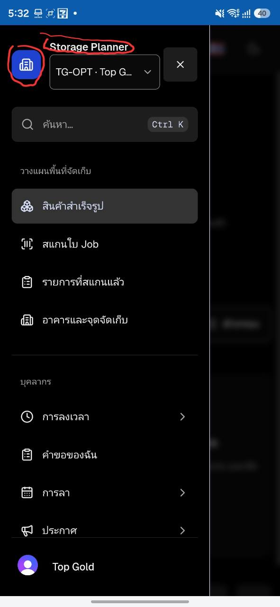
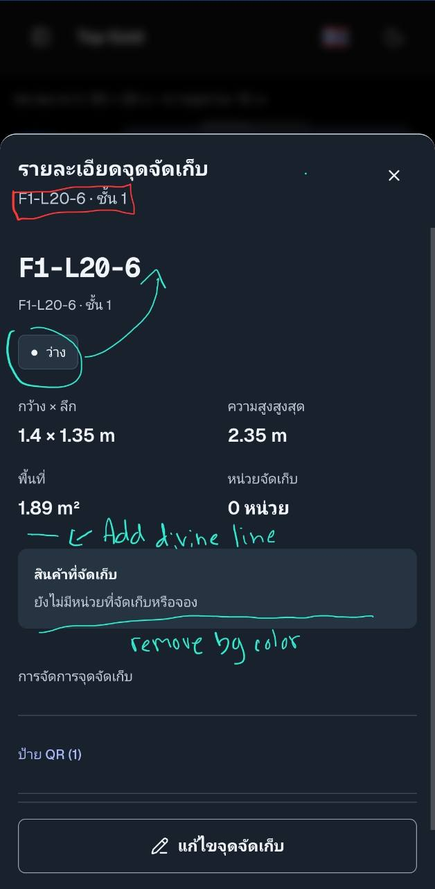
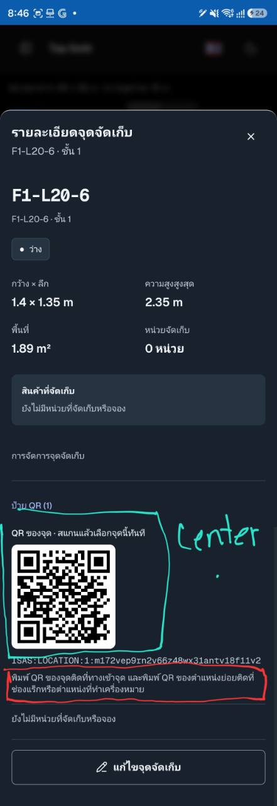

# แผนปรับ UI จากภาพและ frontend audit

วันที่: 13 ตุลาคม 2026  
สถานะ: รวบรวมภาพและทำแผนเท่านั้น — ยังไม่แก้โค้ด UI

## เป้าหมายและขอบเขต

ลดองค์ประกอบที่ผู้ใช้วงสีแดงออกจาก UI โดยเริ่มจากเมนู Sidebar บนมือถือในภาพแรก เพื่อให้ส่วนเลือกคลังและเมนูใช้งานมีพื้นที่มากขึ้น

ภาพถัดมาใช้สีเขียวระบุการย้ายตำแหน่ง จัดกึ่งกลาง เพิ่มเส้นแบ่ง และเอาพื้นหลังบางส่วนออก การเปลี่ยนแปลงแต่ละจุดระบุแยกตามภาพ ไม่เปลี่ยนสีทั้งระบบ

ไฟล์นี้เป็นแผนสะสมสำหรับภาพที่จะส่งเพิ่ม แต่ละภาพจะมีรายการเปลี่ยนแปลง จุดแก้ในโค้ด และเกณฑ์ตรวจรับแยกกัน ยังไม่เริ่ม implementation จนกว่าผู้ใช้จะสั่งให้ทำ

## ผลตรวจร่วมกับ Kiro

[รายงาน Kiro พร้อมตารางตรวจทั้ง 8 จุด](../reviews/ui-cleanup-2026-10-13/kiro-review.md) ยืนยันว่าเปิดดูพิกเซลของทั้ง 3 ภาพสำเร็จ และการตีความเครื่องหมายใน UI-001 ถึง UI-008 ตรงกับภาพ การตรวจรอบนี้ใช้ `claude-opus-5.5` / high effort เป็นการรีวิวภาพ แผน และ source เท่านั้น

**ข้อแก้ไขสำคัญ:** โค้ดใน working tree กับ `origin/main` ที่อยู่ในเครื่องแตกต่างกัน ภาพมีโครงสร้าง Sidebar และข้อความ QR สอดคล้องกับ `origin/main@7a33448d` มากกว่า local `HEAD@733c6aca` จึงห้ามสรุปจาก local เพียงชุดเดียวว่าข้อความในภาพถูกลบไปแล้ว ยังไม่ได้ fetch ใหม่หรือยืนยันว่า deployment ในภาพใช้ commit ใด

จุดอ้างอิงแบบชื่อไฟล์/symbol ด้านล่างต้องตรวจซ้ำบนฐานงานจริงก่อน implementation; เลขบรรทัดของ `origin/main@7a33448d` อยู่ในรายงาน Kiro หากเริ่มจาก main ให้ใช้ checkout/worktree แยกจากงานที่ค้างอยู่ และตรวจว่ามีงานที่ต้องนำมาร่วมด้วยก่อนลงมือ ไม่ reset หรือเขียนทับ working tree ปัจจุบัน

| ปัญหา / รายการ                                  | สิ่งที่ควรทำ                                          | มั่นใจแค่ไหนว่าเป็นปัญหา                                                      |
| ----------------------------------------------- | ----------------------------------------------------- | ----------------------------------------------------------------------------- |
| UI-001 ไอคอน branding กินพื้นที่ใน Sidebar      | ลบตามที่วงแดง แล้วคืนพื้นที่ให้ข้อมูลคลัง             | สูงว่าเป็นความต้องการผู้ใช้; ยังไม่มีหลักฐานว่าไอคอนทำให้ใช้งานผิดพลาด        |
| UI-002 ชื่อ Storage Planner เหนือคลัง           | ลบตามที่วงแดงและยุบช่องว่าง                           | สูงว่าเป็นความต้องการผู้ใช้; เป็นการลดข้อมูลตามโจทย์ ไม่ใช่ functional defect |
| UI-003 รหัส/ชั้นซ้ำใน Sheet header และเนื้อหา   | ซ่อน subtitle ใน header ด้วย `sr-only` เฉพาะ location | สูง: เห็นความซ้ำทั้งในภาพและ source                                           |
| UI-004 สถานะแยกห่างจากรหัส                      | ย้าย badge ข้างรหัสและให้ wrap ได้                    | กลางว่า layout เดิมเป็นปัญหา UX; สูงว่าลูกศรสื่อให้ย้ายตำแหน่งนี้             |
| UI-005 ข้อมูลขนาดกับสินค้าต้องการเส้นแบ่ง       | เพิ่ม divider หนึ่งเส้นเหนือสินค้าที่จัดเก็บ          | กลางว่าเส้นช่วยอ่านกลุ่มข้อมูล; สูงว่าเป็นคำขอในภาพ                           |
| UI-006 กล่องสินค้ามีพื้นหลังที่ผู้ใช้ไม่ต้องการ | เอาพื้นหลัง/padding แบบ card ออกตามภาพ                | สูงว่าเป็นความต้องการด้านภาพ; ไม่อ้างว่าสีเดิมผิดมาตรฐาน                      |
| UI-007 caption และ QR หลักชิดซ้าย               | จัดสองส่วนนี้กลางโดยคงขนาดและขอบขาว                   | สูงว่าตรงกับ annotation; ยังไม่มีหลักฐานว่าการจัดซ้ายทำให้สแกนไม่ได้          |
| UI-008 คำแนะนำพิมพ์ QR ที่วงแดง                 | ลบการแสดงย่อหน้านี้บนฐานที่ยังมีข้อความ               | สูง: วงแดงชัดและพบ source/key ใน `origin/main@7a33448d`                       |

ความมั่นใจในตารางแยกระหว่างความชัดเจนของคำขอและหลักฐานว่าเป็นข้อบกพร่อง ไม่ได้ตีความว่าความชอบด้านภาพทุกข้อเป็นปัญหาการใช้งานที่ผ่าน user test แล้ว ขอบเขต Desktop ยังรอคำตอบทั้ง Sidebar และรายละเอียดจุดจัดเก็บ

## ภาพที่ 1 — Header ของ Sidebar

ภาพต้นฉบับ: [1000035454.jpg](assets/ui-cleanup-2026-10-13/1000035454.jpg)



สีแดงในภาพเป็นเครื่องหมายระบุองค์ประกอบที่ให้ลบ ไม่ใช่คำขอให้เปลี่ยนสีของระบบ

| รหัส   | จุดที่วงสีแดง                         | แผนเปลี่ยนแปลง                                    | เกณฑ์ตรวจรับ                                                         |
| ------ | ------------------------------------- | ------------------------------------------------- | -------------------------------------------------------------------- |
| UI-001 | ไอคอนอาคารในกล่องสีน้ำเงิน ด้านบนซ้าย | ลบกล่องและไอคอนเฉพาะส่วน branding ใน header       | ไม่เห็นไอคอนหรือกล่องสีน้ำเงินตรงนี้ และไม่เหลือช่องว่างแทนกล่องเดิม |
| UI-002 | ข้อความ `Storage Planner` ด้านบน      | ลบชื่อแอปที่แสดงใน header และยุบพื้นที่ของแถวชื่อ | ไม่เห็นชื่อแอปตรงนี้ และไม่มีแถวว่างจากชื่อที่ลบ                     |

### การจัดวางหลังลบ

1. บนมือถือ ให้ช่องเลือกคลังหรือชื่อคลังปัจจุบันเป็นข้อมูลหลักที่ด้านบน และมีปุ่มปิด `X` อยู่ด้านขวา
2. จัดสองส่วนนี้ในแถวเดียวเมื่อมีพื้นที่พอ โดยให้ชื่อคลังใช้พื้นที่ที่เหลือและไม่เบียดปุ่มปิด
3. วาง Search ต่อใต้แถวข้อมูลคลัง ใช้ระยะห่างและขนาดปุ่มจากระบบเดิม
4. ชื่อคลังยาวต้องอ่านและใช้งานได้ตามพฤติกรรมของคอมโพเนนต์เดิม โดยไม่เกิด horizontal scroll หรือปุ่มซ้อนกัน

โครงสร้างเป้าหมายบนมือถือ:

```text
┌──────────────────────────────────┐
│ [คลังที่เลือก / ชื่อคลัง]     [X] │
│ [Search / Search triggers เดิม]  │
├──────────────────────────────────┤
│ กลุ่มเมนูและรายการเมนูเดิม        │
│                                  │
│ บัญชี / องค์กร                    │
└──────────────────────────────────┘
```

### จุดแก้ในโค้ดเมื่อเริ่ม implementation

- [`src/components/examples/c-sidebar-2.tsx`](../../src/components/examples/c-sidebar-2.tsx) — ฟังก์ชัน `AppSidebar` ส่วน `SidebarHeader`: ลบเฉพาะกล่อง branding ที่มี `Building2` และ `app("name")` ตามขอบเขตอุปกรณ์ที่ตกลง แล้วจัดตำแหน่ง `WorkspaceContext` กับ `NavigationDisclosure`
- ตรวจการใช้งาน `Building2` และตัวแปร `app` หลังแก้ตามขอบเขตจอที่ตกลง: local ยังใช้ในเมนู/footer แต่ `origin/main@7a33448d` ใช้สองตัวนี้เฉพาะ branding ในไฟล์นี้ หากลบทั้งมือถือและ Desktop จึงลบ import/ตัวแปรที่ไม่ใช้ได้; หากลบเฉพาะมือถือยังต้องเก็บสำหรับ Desktop
- คง translation `App.name` เพราะส่วนอื่นยังใช้งาน รวมชื่อสำรองขององค์กร ไม่เปลี่ยนชื่อแอปทั้งระบบ
- [`src/components/ui/sidebar.tsx`](../../src/components/ui/sidebar.tsx) มี `SheetTitle` แบบ `sr-only` สำหรับชื่อเมนูที่ screen reader อ่าน ต้องคงชื่อและ shared Sheet ที่เป็นเจ้าของการเปิด/ปิดไว้
- [`src/components/examples/c-sidebar-2.test.tsx`](../../src/components/examples/c-sidebar-2.test.tsx) — ใช้ทดสอบ shell เดิมเพื่อยืนยันว่าเลือกคลัง ปิดเมนู และเปิด Search ยังทำงาน

local working tree มี Search และ AI Search แยกกัน ส่วนภาพและ `origin/main@7a33448d` มี Search ปุ่มเดียว ให้คง Search controls ของฐานงานจริงไว้; UI-001/002 ไม่ครอบคลุมการเพิ่มหรือลบ Search controls

### ขอบเขตที่รอคำตอบ

- **มือถือ:** อยู่ในขอบเขตภาพแรกแน่นอน
- **Desktop:** รอคำตอบว่าจะลบ branding ด้วยหรือไม่ หากลบ ให้ครอบคลุมทั้ง Sidebar แบบขยายและแบบย่อ โดยยังคงปุ่มเปิด/ย่อเมนูและ Search
- ภาพเพิ่มเติมจะนำมาต่อท้ายแผนนี้ โดยไม่เดาจุดแก้ที่ยังไม่ได้ส่ง

### สิ่งที่คงไว้สำหรับภาพนี้

ช่องเลือกคลัง ปุ่มปิด Search/AI Search กลุ่มเมนู รายการเมนู สถานะเมนูที่เลือก และบัญชีด้านล่างยังใช้งานตามเดิม ไม่มีคำขอให้เพิ่มรูปตกแต่งหรือเปลี่ยนสีทั้งระบบจากภาพนี้

## ภาพที่ 2 — รายละเอียดจุดจัดเก็บ: Header, สถานะ และสินค้าที่จัดเก็บ

ภาพต้นฉบับ: [1000035458.jpg](assets/ui-cleanup-2026-10-13/1000035458.jpg)



| รหัส   | ปัญหา / จุดที่ระบุ                                                                   | สิ่งที่ควรทำ                                                                                                                                 | เกณฑ์ตรวจรับ                                                                                                                |
| ------ | ------------------------------------------------------------------------------------ | -------------------------------------------------------------------------------------------------------------------------------------------- | --------------------------------------------------------------------------------------------------------------------------- |
| UI-003 | สีแดง: `F1-L20-6 · ชั้น 1` ใต้หัวข้อ “รายละเอียดจุดจัดเก็บ” ซ้ำกับ context ในเนื้อหา | ซ่อน subtitle ใน Sheet header ของ location ด้วย `sr-only`; คงรหัส/ชื่อ/ชั้นในเนื้อหาและชื่อ Sheet ที่ screen reader ใช้                      | Header เหลือชื่อ “รายละเอียดจุดจัดเก็บ” กับปุ่มปิด ไม่มีแถว subtitle หรือช่องว่างเดิม; screen reader ยังเข้าถึงรหัส/ชั้นได้ |
| UI-004 | สีเขียว: badge “ว่าง” อยู่แยกใต้รหัสและลูกศรชี้ขึ้นไปข้างรหัส                        | ย้าย badge มาอยู่แถวเดียวกับรหัสหลัก `F1-L20-6` เมื่อพื้นที่พอ โดยวางเป็น sibling ของ `h3` ให้ heading ยังคงเป็นรหัสล้วน                     | รหัสกับ badge อยู่ข้างกันบนขนาดปกติ; รหัสยาว wrap ได้โดยไม่ทับสถานะ; สถานะมีสินค้า/จอง/ยังไม่ครบข้อมูลยังแสดงตามข้อมูลจริง  |
| UI-005 | สีเขียว: “Add divider line” เหนือสินค้าที่จัดเก็บ                                    | เพิ่มเส้นแบ่งหนึ่งเส้นระหว่างข้อมูลขนาด/พื้นที่/จำนวน กับหัวข้อ “สินค้าที่จัดเก็บ” ใช้ border token เดิม                                     | เห็นการแบ่งกลุ่มใน light/dark โดยไม่เพิ่มหลายเส้นติดกันหรือเว้นพื้นที่เกินจำเป็น                                            |
| UI-006 | สีเขียว: “remove bg color” ที่กล่องสินค้าที่จัดเก็บ                                  | เอาสีพื้นหลังแบบ raised และรูปทรง card ออกจากส่วนนี้ ให้หัวข้อและข้อความอยู่บนพื้นเดียวกับรายละเอียดหลัก ปรับ padding ให้ตรงแนวข้อมูลรอบข้าง | ไม่มีพื้นสีของ card เดิม แต่ยังเห็นหัวข้อ ข้อความ empty state หรือชื่อสินค้าจริง รวมจำนวนและข้อมูลที่ยังไม่ครบตามเดิม       |

### จุดแก้และขอบเขตในโค้ด

- [`src/components/storageLayouts/FloorMap.tsx`](../../src/components/storageLayouts/FloorMap.tsx) — `SheetHeader`/`SheetDescription` ของ bottom Sheet เป็นเจ้าของ subtitle ที่วงแดง ทำเฉพาะรายละเอียด location ตามภาพ; reserved-area details เป็นอีกบริบทที่ต้องตรวจไม่ให้ถูกเปลี่ยนตามโดยอัตโนมัติ
- [`src/features/storageLayouts/StorageZonesPanel.tsx`](../../src/features/storageLayouts/StorageZonesPanel.tsx) — ส่วน `compact` ใน `locationDetails` แสดงรหัส `h3`, context, status, metrics และ inventory เป็นเจ้าของการย้าย badge กับ divider
- [`src/components/storageLayouts/FloorMap.module.css`](../../src/components/storageLayouts/FloorMap.module.css) — `.status` มี `margin-top` และ `.inventory` มี raised background/padding/radius ต้องปรับให้สัมพันธ์กับ layout ใหม่ โดยตรวจ consumers ก่อนเปลี่ยน shared class
- คง [`LocationDetailsHost`](../../src/components/storageLayouts/LocationDetailsHost.tsx) และการส่งรายละเอียดไป mobile Sheet/desktop inspector ตามเดิม การย้าย DOM presentation ไม่ควร remount editor หรือเปลี่ยน ownership ของ Back
- `compact` ใช้ร่วมกันระหว่าง mobile Sheet และ desktop inspector จึงต้องรอคำตอบขอบเขต Desktop ก่อนลงมือ; list view ไม่มี compact layout ชุดนี้ และไม่สร้าง layout ใหม่ให้ list โดยอัตโนมัติ

ตัวอย่างลำดับข้อมูลเป้าหมาย:

```text
รายละเอียดจุดจัดเก็บ                         [X]

F1-L20-6       [● ว่าง]
ชื่อ/รหัสจุดจัดเก็บ · ชั้น 1

กว้าง × ลึก             ความสูงสูงสุด
1.4 × 1.35 m            2.35 m
พื้นที่                   หน่วยจัดเก็บ
1.89 m²                  0 หน่วย
──────────────────────────────────────────
สินค้าที่จัดเก็บ
ยังไม่มีหน่วยที่จัดเก็บหรือจอง

การจัดการจุดจัดเก็บ / ส่วน QR / ปุ่มแก้ไขเดิม
```

## ภาพที่ 3 — รายละเอียดจุดจัดเก็บ: ส่วน QR ที่เปิดอยู่

ภาพต้นฉบับ: [1000035459.jpg](assets/ui-cleanup-2026-10-13/1000035459.jpg)



ภาพที่ 2 และ 3 เป็น surface เดียวกัน โดยภาพนี้เปิดส่วน QR อยู่ จึงใช้ UI-003 ถึง UI-006 ร่วมกัน ไม่ทำ layout ใหม่สองชุด

| รหัส   | ปัญหา / จุดที่ระบุ                                                                | สิ่งที่ควรทำ                                                                                                                                 | เกณฑ์ตรวจรับ                                                                                                              |
| ------ | --------------------------------------------------------------------------------- | -------------------------------------------------------------------------------------------------------------------------------------------- | ------------------------------------------------------------------------------------------------------------------------- |
| UI-007 | สีเขียว: กลุ่ม QR ชิดซ้าย พร้อมคำว่า “Center”                                     | จัด caption และ QR หลักกึ่งกลางด้วย wrapper ในเนื้อหาที่กางออก ไม่ย้าย summary “ป้าย QR (1)” ไปกลาง; คงแนวซ้ายของค่า QR ซึ่งอยู่นอกกรอบเขียว | caption และ QR อยู่กึ่งกลางเมื่อเปิด; รูปยังเป็นสี่เหลี่ยม ไม่ stretch และค่า QR ยาว wrap ได้โดยไม่เกิด horizontal scroll |
| UI-008 | สีแดง: ย่อหน้า “พิมพ์ QR ของจุดติดที่ทางเข้าจุด … ตำแหน่งที่ทำเครื่องหมาย” ใต้ QR | ลบย่อหน้าที่ render `layoutActions.qr.help` ในฐานงานที่ยังมีข้อความนี้; ตรวจ references ก่อนลบ key th/en และทำตามขอบเขต Desktop ที่ตกลง      | ไม่เห็นย่อหน้าที่วงแดง แต่ยังเปิด/ปิด QR และแสดง label/value ของจุดและตำแหน่งจริงได้                                      |

### Source ปัจจุบันและข้อจำกัดของภาพ

- [`StorageZonesPanel.tsx`](../../src/features/storageLayouts/StorageZonesPanel.tsx) แสดง QR หลักในส่วน `<details>` ที่ใช้ `spotLabels`; ใน `compact` ใช้ `LocationQrCode` กับ `className="mt-2"` และมี `code` แสดง `zone.qrValue` ต่อด้านล่าง จุดนี้เป็นเป้าหมายหลักของการจัดกลาง
- Caption “QR ของจุด · สแกนแล้วเลือกจุดนี้ทันที” และคำแนะนำการพิมพ์ไม่อยู่ใน local working tree ที่ตรวจครั้งแรก แต่ **มีอยู่ใน `origin/main@7a33448d`**: `layoutActions.qr.area`/`areaAuto` และ `layoutActions.qr.help` ใน `StorageZonesPanel.tsx` และ `messages/th.json`/`en.json` การสรุปก่อนหน้านี้ว่าข้อความไม่มีแล้วจึงใช้ได้เฉพาะ local เท่านั้น
- UI-008 เป็นงานลบจริงหากเริ่มจากฐานที่ตรงกับภาพ; ใน `origin/main@7a33448d` ย่อหน้านี้อยู่นอก `compact` จึงแสดงทั้ง inspector และ list view ด้วย หากผู้ใช้เลือกแก้เฉพาะมือถือ ต้องคงข้อความและ translation สำหรับ Desktop; ถ้าใช้ทุกจอและไม่มี reference อื่นจึงลบ key ได้
- UI-007 คง caption ตามความหมายเดิมของจุดที่มี/ไม่มีตำแหน่งย่อยบนฐานที่มี caption อยู่ ไม่เพิ่ม caption ใหม่ให้ฐานที่ไม่มีเพียงเพื่อให้เหมือน screenshot โดยไม่ตรวจการเปลี่ยนแปลงก่อนหน้า
- [`src/features/storageKit/QrCode.tsx`](../../src/features/storageKit/QrCode.tsx) ใช้กรอบสีขาวและ padding สำหรับความชัดของ QR เอาพื้นหลังออกตาม UI-006 เฉพาะส่วนสินค้าที่จัดเก็บ; รักษากรอบและ padding ของ QR
- คงรายการตำแหน่งย่อยที่มี QR ต่างจากจุดหลัก จำนวนป้าย การค้นหา และค่า QR เดิม การจัดกลางของ QR หลักไม่บังคับรายการตำแหน่งย่อยทั้งหมดให้เป็น card กลาง
- คงขนาด QR หลัก `128` และ padding `8` ตามคอมโพเนนต์เดิม ตรวจการสแกนจากจอจริงหลังแก้; test รูปทรงและขนาดเพียงอย่างเดียวไม่ได้พิสูจน์ว่าสแกนได้ทุกอุปกรณ์
- ข้อความ empty state ที่ปรากฏซ้ำใต้ QR ไม่ได้ถูกวงให้ลบ จึงยังไม่เพิ่มเป็นงานในรอบนี้

### ตรวจรับร่วมสำหรับภาพที่ 2 และ 3

- ตรวจ QR ทั้งปิดและเปิด, จุดที่ไม่มีตำแหน่งย่อย และจุดที่มีหลายตำแหน่งย่อย
- ตรวจสถานะว่าง/มีสินค้า/จอง/ยังไม่ครบข้อมูล รวมชื่อและรหัสยาว โดยไม่ใช้ข้อความ “ว่าง” เมื่อข้อมูลยังไม่ครบ
- ตรวจ mobile Sheet ที่ 320/390/430 CSS px, ภาษาไทย/อังกฤษ และ light/dark; desktop inspector/list ต้องตรวจทั้งกรณีผู้ใช้เลือกให้เปลี่ยนร่วมกันหรือให้คง layout เดิม
- คงปุ่มปิดและแก้ไข การคืน focus และการปิด Sheet ก่อนเปิด editor ผ่าน `detailsHost.runAction`; คง read-only และ pending/draft protection
- ใช้ literal regression cases ที่มีอยู่จริงใน [`StorageLayoutScreens.test.tsx`](../../src/features/storageLayouts/StorageLayoutScreens.test.tsx): `keeps the zone QR scannable in compact details without child positions`, `removes duplicate default QR labels but retains and searches distinct positions` และ `shows reserved and stored exact positions on spot cards with pallet links and unchanged square QR boxes`
- เคส `native Back dismisses the mobile location inspector before leaving the building` อยู่ใน `StorageLayoutScreens.test.tsx` ของ local แต่ย้ายไป `src/features/storageLayouts/StorageLayoutNavigation.test.tsx` ใน `origin/main@7a33448d`; ใช้ไฟล์ที่เป็นเจ้าของจริงบนฐานงานนั้น
- หาก semantic component/role targets หรือการเปิด/ปิดเปลี่ยน ต้องทบทวน inventory ตาม contract และตรวจ caller-specific Close → Back, direct link, locale/query/hash, nested foreground, draft/pending, Forward และ remount ตามที่กระทบจริง

รายการนี้เป็นแผนจากภาพและ source เท่านั้น ยังไม่ได้รัน runtime tests หรือสร้างภาพ UI หลังแก้

## ขั้นตอนทำงานเมื่อได้รับคำสั่งให้เริ่ม

1. ทบทวนภาพทั้งหมดและคำตอบเรื่อง Desktop ทั้งสองส่วน แล้วล็อกรายการ UI ที่จะทำในรอบนั้น ตรวจฐานงานจริงและเปรียบเทียบกับ local/origin ที่ระบุไว้ข้างต้นโดยรักษางานที่ค้างอยู่
2. อ่านคู่มือ Next.js ที่เกี่ยวข้องใน `node_modules/next/dist/docs/` และ craft floor ของ skill ก่อนแก้ UI ตามกติกาโครงการ
3. แก้ `AppSidebar` และรายละเอียดจุดจัดเก็บเฉพาะรายการที่ระบุไว้ โดยใช้ theme tokens และคอมโพเนนต์เดิม ตรวจ baseline อีกครั้งเพื่อไม่แก้ข้อที่หายไปแล้ว
4. หากเปลี่ยน conditional branch หรือ semantic component/role targets ให้ทบทวน [`Back navigation contract`](../contracts/back-navigation.md) และ [`inventory`](../contracts/back-navigation.json) เป็นรายจุด ห้ามเปลี่ยน history ownership หรือเพิ่มข้อยกเว้นเพื่อให้ gate ผ่าน
5. ตรวจภาพมือถือและ Desktop ในรอบเดียว แก้ข้อผิดพลาดที่พบเป็นชุด แล้วตรวจยืนยันอีกไม่เกินหนึ่งรอบ

## การตรวจรับหลัง implementation

- ส่วนที่วงแดงหายไปตามขอบเขตอุปกรณ์ที่ตกลง ไม่มีช่องว่างเหลือจาก branding และปุ่มปิดไม่ถูกบัง
- ตรวจมือถือที่ความกว้าง 320, 390 และ 430 CSS px รวมชื่อคลังยาวและหน้าที่แสดงชื่อคลังแทนตัวเลือก
- ตรวจ Desktop ทั้ง Sidebar แบบย่อและขยายตามขอบเขตที่ตกลง เพื่อจับผลกระทบจากคอมโพเนนต์ร่วม
- ตรวจภาษาไทย/อังกฤษและธีม light/dark; ปุ่มปิดยังมีชื่อที่อ่านได้ ขนาดสัมผัสและ focus ใช้มาตรฐานเดิม
- ตรวจการเลือกคลัง เมนูนำทาง และ Search controls ของฐานงานจริง โดยเฉพาะการปิด drawer ก่อนเปิด Search และการคืน focus
- สำหรับ `origin/main@7a33448d` ใช้ชื่อเคสใน `c-sidebar-2.test.tsx`: `keeps search and warehouse context inside the drawer, with only a flag in the header`, `closes the drawer before opening search and restores focus to the mobile menu`, `starts expanded with a flag-only header and exactly one disclosure inside the desktop sidebar` และ `hands focus to the warehouse selector when the rail warehouse expands the sidebar`
- ชื่อเคส `keeps only menu, flag-only language and theme in the header; the drawer holds workspace and Search`, `opens Search only after the drawer has closed, and Escape returns to the header menu` และ `never opens Search after an ordinary drawer close` มีใน local working tree ที่ตรวจครั้งแรก ไม่ใช้เป็นหลักฐานว่าอยู่ใน main ด้วย ต้องตรวจชื่อเคสและรันบนฐานจริง
- ถ้าแตะพฤติกรรมการเปิด/ปิดหรือ navigation ต้องมี caller coverage สำหรับ native Back, ปิดด้วย X แล้ว Back ครั้งถัดไป, direct link, locale/query/hash, draft/pending write, nested foreground, Forward และ remount ตาม contract; เคสที่ยังไม่มีต้องเพิ่มและรันจริงก่อนอ้างเป็นหลักฐาน
- รัน `pnpm lint`, `pnpm check:navigation` และ caller tests ของ shell/sidebar/storage ที่เกี่ยวข้อง เพราะไฟล์ที่แตะอยู่ใน navigation inventory; หากแก้ navigation ให้ทำ runtime coverage ตาม contract ด้วย และตรวจ UI ด้วย detector ของ skill เมื่อแก้เสร็จ

การตรวจรับด้านบนเป็นงานในอนาคต ยังไม่ได้รันหรืออ้างว่าผ่านในการทำแผนครั้งนี้

## คำถามขอบเขตที่รอผู้ใช้ตอบหลัง Kiro review

1. ลบไอคอนอาคารและชื่อ `Storage Planner` บน Desktop sidebar ด้วย หรือเฉพาะมือถือ?
2. ให้ UI-004 ถึง UI-008 ใช้กับ Desktop ด้วยหรือเฉพาะมือถือ? คำแนะนำคือใช้ร่วมกันใน desktop inspector สำหรับ layout ที่มีอยู่แล้ว และลบคำแนะนำพิมพ์ใน desktop list ด้วย ไม่เพิ่ม compact layout เข้า list

ทั้งสองข้อเป็นคำถามเรื่องผลลัพธ์บน Desktop ไม่ใช่การขออนุมัติเริ่ม implementation หากยังไม่มีคำตอบ ให้เก็บขอบเขต Desktop เป็นรอตัดสินใจ ส่วนการใช้ `sr-only`, badge อยู่นอก heading, ค่า QR คงชิดซ้าย และการรักษาขอบขาว QR ตัดสินใจได้จากหลักฐานที่มี

## ภาพเพิ่มเติม

มีภาพอ้างอิงสะสม 3 ภาพ และรายการ UI-001 ถึง UI-008 เมื่อได้รับรูปถัดไป จะเพิ่มหัวข้อ `ภาพที่ 4`, `ภาพที่ 5`, … และรหัส `UI-009` เป็นต้นไป พร้อมขอบเขตและเกณฑ์ตรวจรับของแต่ละจุด

## รายการเพิ่มเติมจาก frontend audit

ผล research ของข้อเสนอทั้ง 18 กลุ่มอยู่ใน [ตารางคัดรายการ UX/UI ที่ควรทำ](../reviews/frontend-consistency-2026-10-13/decision-review-th.md) โดยแยกปัญหาที่ยังอยู่จริง ส่วนที่แก้แล้ว และข้อเสนอที่ควรทำแบบมีเงื่อนไข พร้อมระดับความมั่นใจและหลักฐาน source

เริ่มพิจารณาความถูกต้องของกล้อง การล็อกข้อมูลระหว่าง pending และขอบเขตคำสั่งเปลี่ยนสถานะอาคารก่อน งาน refactor/layout ที่ยังไม่มีหลักฐานผลกระทบให้รอการตรวจเพิ่มเติม รายการเหล่านี้ยังเป็นแผน และยังไม่เริ่มแก้ application code
