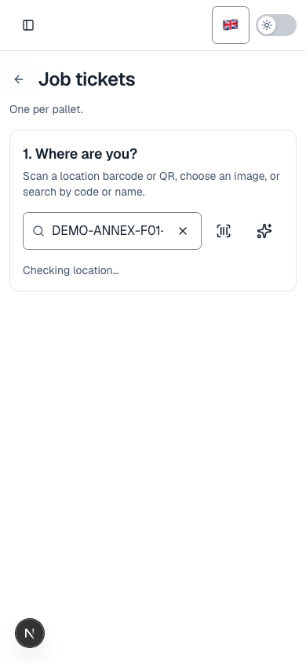
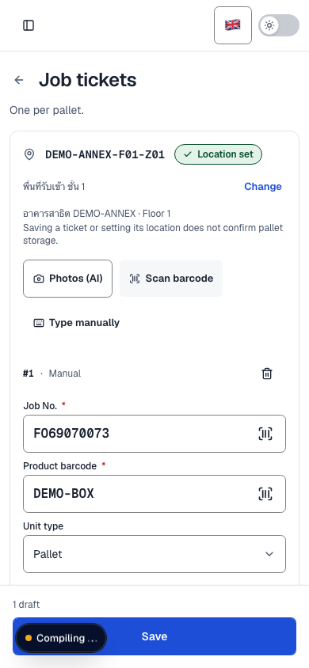
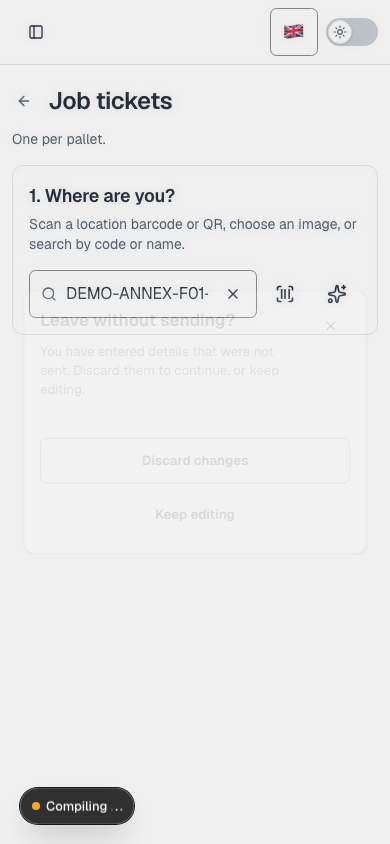
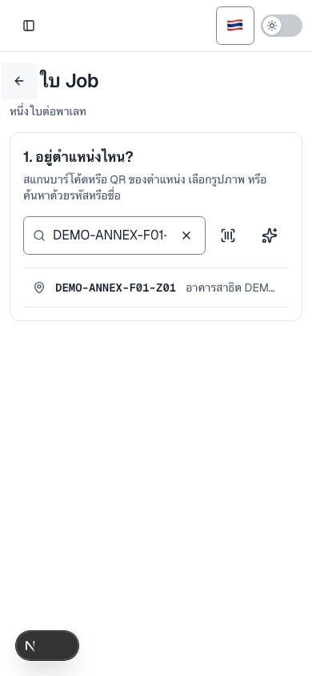

# Back within Location workflows

The reported interaction is fixed in the shared checkout. The primary agent coordinated and reviewed; its Codex subordinate made the changes, with a separate Kiro read-only audit. No commits, pushes, deployment, tickets, record mutations, or seeding were performed. Existing dirty work and the October 12 navigation fixes were retained.

## Confirmed cause and behavior

Choosing a Location in `JobScanScreen` changed React state only. The rendered header still used ordinary page Back, so browser/device Back and the header arrow had no earlier workflow entry to restore. They returned to an earlier page instead of **1. Where are you?** The records screen's inline Location assignment picker had the same omission.

Both transitions now use the existing native query/history helpers. Shared page Back gives an active workflow predecessor priority. Returning to the question retains the selected location and entered tickets; choosing again keeps those ticket values. Scanner callbacks are invalidated, and leaving after that still asks about unsent tickets. In-flight writes remain blocked. Success → Back → choose resets acquisition, allowing a new ticket to save; Scan more starts with an empty ticket set.

The draft guard grants internal transitions only when every draft it owns explicitly consents to the calling workflow scope. Other forms/guards still ask. Its buffer is rearmed only on the original pathname; an unbuffered dirty departure is restored before showing the prompt. Back-handler registration has stable ordering. No separate history stack was added.

A direct link or refresh cannot reconstruct local unsent data, so an orphaned workflow query resets to the location question. The existing unload confirmation still protects a dirty refresh. Direct-link page Back has module fallbacks: scan/records → `/finished-goods`; HR request detail → `/hr/requests`. Native history remains responsible for the actual prior page and its locale/query/hash. No externally supplied return URL was introduced.

The independent review also caught completed/invalidated owned steps being replaced with identical question/list entries. Those entries are now consumed through native history, retaining current filter/search/page/query/hash intent; missing-origin deep links use replacement. Records assignment completion, filter/search/page invalidation, and an owned scan remount have caller regressions for the next Back reaching the actual origin.

The same dead-step bug was independently reproduced in the actual HR Employees screen: editor open pushed, Cancel replaced that editor entry with a second copy of the list, and next Back stayed on the list. Editor opens now retain unrelated list query/hash and record validated list provenance in the existing native entry. Owned Cancel consumes that editor entry through the existing guard; direct links clean only editor parameters and stay in Employees. Tests include pristine/dirty Cancel, preserved list query/hash, owned remount, direct link, and a pending write. Other inline business views were not redesigned.

## Reproduction and checks

Before fixing, this actual caller regression failed: choosing Location then clicking the real `PageHeader`/`PageBackButton` never rendered the question, and invoked route Back:

```sh
pnpm exec vitest run src/features/finishedGoods/jobScan/JobScanScreen.test.tsx --maxWorkers 2 -t 'returns to the location question'
# Before: 1 failed. After: passed.
pnpm exec vitest run src/features/finishedGoods/jobScan/JobScanRecords.test.tsx --maxWorkers 2 -t 'Back closes Location'
# Before: 2 failed (header and browser Back). After: both passed.
```

Regression tests drive real native jsdom Back/Forward through the workflow/provider/guard callers, with backend and routing dependencies mocked. They cover entered tickets, choosing again, Change location, another dirty form, pending writes, success/Scan more, late scanner callbacks, repeated Back, a cross-module origin, locale/query/hash, missing local state, same-URL router state replacement, active-menu navigation, records selection, and HR request-detail fallback.

- Broad relevant suite: **90 files / 953 tests passed**, two workers. The command below includes HR, storage, finished goods, hooks, draft guards, navigation progress, query history, locale switching, and sidebar controls.
- Later completion/invalidation/remount corrections passed **4 files / 84 tests**; Employees navigation and self-service passed **2 files / 13 tests**.
- `pnpm typecheck` passed. Scoped ESLint with zero warnings, scoped Prettier, and `git diff --check` passed. No pre-existing check failure remained in these runs. A production build was not run.

```sh
pnpm exec vitest run src/features/hr src/features/storageLayouts src/features/finishedGoods src/hooks src/components/system src/components/providers/DraftGuardProvider.test.tsx src/components/ui/PageBackButton.test.tsx src/lib/browser/history.test.ts src/components/shell/LocaleSwitcher.test.tsx src/components/shell/SidebarNavigationLink.test.tsx src/components/examples/c-sidebar-2.test.tsx --maxWorkers 2
pnpm typecheck
```

Authenticated local Chromium also passed the scan and actual records flow using the existing local test account at **390 × 844**: header/browser Back, retained dirty ticket, a subsequent leaving Back/Keep editing prompt, accepted refresh, and records assignment Back. There were no uncaught page errors and no ticket submissions or record mutations. See [browser-checks.json](browser-checks.json). This is mobile viewport testing, not Android/iOS device testing. Pending/success behavior was tested with mocked writes; no real save was sent.

The final Thai run additionally passed Choose Location → Back with `/th`, unrelated query and fragment retained, the actual active sidebar link → Keep editing, and two rapid native `history.back()` requests with the draft retained. It captured zero page and console errors: [browser-thai-checks.json](browser-thai-checks.json). The first combined probe queried fields while the drawer was still open during dialog accessibility handoff; DOM inspection confirmed the fields/data remained present and the native rapid-Back request had not started. Awaiting drawer closure corrected that probe. `history.go(-n)` and real Android/iOS hardware remain unverified.






## Audited controls

| Area                                                                        | Findings and disposition                                                                                                                                                                                                                  |
| --------------------------------------------------------------------------- | ----------------------------------------------------------------------------------------------------------------------------------------------------------------------------------------------------------------------------------------- |
| Shared `PageHeader`/`PageBackButton`                                        | Changed: honor same-page predecessor; explicit module fallback when supplied. Existing app history/locale routing retained.                                                                                                               |
| Scan Location → tickets                                                     | Changed: native step, retained draft/location, scanner/success cleanup.                                                                                                                                                                   |
| Scanned records → Location assignment                                       | Changed: native step; Back/Cancel returns to selected records; pending writes guarded.                                                                                                                                                    |
| `LocationPicker`                                                            | Changed: the previous location text initializes a reopened picker. QR/image/add-location cancel controls remain their existing local operations.                                                                                          |
| Finished-goods catalogue → product/pallet, measurement/storage              | Already use native query state, route links and breadcrumb fallbacks. Product correction close/return-unit tests remain green. Destination selection and placement editor coexist, so changing selection is not a hidden previous screen. |
| Global goods search / locate destinations                                   | App-built permitted destinations use guarded route pushes; raw return URLs are not accepted. Shared page Back returns through actual history. No caller conversion required.                                                              |
| Storage catalogue / building / floor / zone                                 | Native catalogue view history, building/floor query transitions, review route trails, and dirty workspace guards already exist. Inspector/edit close and Back to edit have explicit local semantics; existing tests remain green.         |
| HR top-level pages and period detail                                        | Shared page Back already present, including loading. Period detail has its parent breadcrumb fallback.                                                                                                                                    |
| HR request detail                                                           | Changed: a directly opened request returns to Requests.                                                                                                                                                                                   |
| HR employees / review / settings                                            | Employees owned editor Cancel consumes its entry and retains list query/hash. Review/settings URL-backed record state and guarded URL transitions remain. Explicit close/selection operations retain their distinct semantics.            |
| Sidebar / modal / drawer / acquisition controls                             | Closing uses their existing close/cancel semantics. Active-menu, draft guard, locale-switching, scanner-modal and sidebar tests remain green.                                                                                             |
| Move destination change, batch review/done, packing review, period creation | Audited as separate business views/inline forms or dialogs with their own cancellation/completion semantics. No speculative workflow redesign was applied.                                                                                |

## Exact implementation scope

These are the subordinate's source/test changes, separate from the pre-existing dirty tree:

- `src/lib/navigationGuard.ts`: workflow Back registration and scoped internal-transition options.
- `src/components/ui/PageBackButton.tsx`: consult workflow Back before ordinary page history.
- `src/components/ui/PageHeader.tsx`, `src/features/finishedGoods/shared.tsx`: explicit fallback prop and forwarding.
- `src/components/system/useNavigationGuard.tsx`: scoped draft consent, local history rearming/restoration, accepted departure handling; its test adds the unbuffered dirty-route regression.
- `src/components/providers/draftGuard.ts`, `DraftGuardProvider.tsx`: optional form workflow scope; consent includes every registered draft.
- New `src/hooks/useWorkflowStep.ts`: existing native query/history step, stable Back handler, missing-data fallback, traversal coalescing and departure callback.
- `JobScanScreen.tsx`: Location step and guard scope, retained location/tickets, scanner/success cleanup, module fallback; its test adds caller regressions and stable router doubles.
- `LocationPicker.tsx`: optional `initialText`.
- `JobScanRecords.tsx`: assignment step, pending guard, Back/Cancel and module fallback; its test adds header/native Back regressions.
- Existing untracked `src/features/hr/RequestsScreen.tsx`: only request-detail fallback; existing untracked `HrNavigation.test.tsx`: import plus direct-link fallback regression.
- `src/lib/browser/history.ts`: optional retained fragment for owned-step collapse; default writes continue to preserve the current fragment.
- `src/features/hr/EmployeesScreen.tsx`: preserved list query/hash, native owned-entry provenance and guarded Cancel; new `EmployeesNavigation.test.tsx` drives the actual screen/form/provider and native history.
- This report, two browser-check metadata files and four screenshots.

Tracked source baselines and the initial dirty diff are at `/tmp/back-navigation-agent-baseline`; the scoped patch is `/tmp/back-workflow-only.patch`. The two pre-existing untracked HR files' patch references were reconstructed by reversing only this task's explicit hunks. Temporary authentication state is removed after runtime checks. The existing local app/backend were started using saved configuration and data, without deploying dirty Convex functions.

## Reusable delegation prompt

```text
คุณเป็นเอเจนต์หลัก ทำหน้าที่จัดงาน ประสานงาน ตรวจผล และสรุปเท่านั้น ห้ามแก้โค้ดเอง ส่งงานให้เอเจนต์รอง Codex หรือ Kiro โดยให้เอเจนต์แก้โค้ดเพียงตัวเดียวในไฟล์ชุดเดียวกัน และให้อีกตัวตรวจแบบ read-only

แก้ปัญหา Back ทั้งปุ่มในหน้าและ browser/device Back: ในหน้า /finished-goods/scan เมื่อเลือก Location จากขั้น “อยู่ตำแหน่งไหน?” แล้วกด Back ต้องกลับขั้นเลือก Location และเก็บ Location/ข้อมูลใบ Job ที่กรอกไว้ การกด Back ต่อจากขั้นแรกจึงกลับหน้าที่เปิดเข้ามาจริง พร้อม locale/query ที่เกี่ยวข้อง ถ้าเปิดลิงก์ตรงหรือ refresh โดยไม่มี state ต้องมี fallback ภายในโมดูลที่แน่นอน

ก่อนแก้ให้อ่าน AGENTS.md, เอกสาร Next.js ที่ติดตั้งจริง, CONTEXT/ADR ถ้ามี และเก็บ baseline ของงานเดิมที่ยังไม่ commit สร้าง regression test ที่เรียกหน้าหรือ hook จริงและรันให้เห็นอาการผิดก่อน ระบุสมมติฐานที่ทดสอบหักล้างได้ แล้วค่อยแก้ต้นเหตุร่วม ตรวจ caller ที่เสี่ยงคล้ายกันใน Location/อาคาร/จัดเก็บ/สินค้าสำเร็จรูป/ค้นหาสินค้า/HR แยก workflow Back, page Back, การปิด modal/drawer และเมนูหลักตามความหมายจริง ห้ามเพิ่ม history stack ซ้ำหรือเปลี่ยนทุกปุ่มโดยเดา

ทดสอบเลือก→Back→เลือกใหม่, การเก็บ draft, Back ซ้ำ, browser Back/Forward, เปิดลิงก์ตรง, refresh, locale/query/hash, pending save, หลัง save/Scan more และ guard/modal interactions การข้าม draft guard ต้องได้รับ consent จาก draft ที่เกี่ยวข้อง ห้ามข้าม guard ของฟอร์มอื่น ตรวจ URL กลับให้เป็น internal ถ้ามีการรับจากภายนอก

รักษางานเดิม ห้าม reset/clean/stash งานคนอื่น ห้าม commit/push/deploy หรือเปลี่ยนข้อมูลธุรกิจ รัน focused tests/typecheck/lint/format ที่เหมาะสม ตรวจ Chromium viewport มือถือเมื่อมีบัญชีทดสอบเดิมและ backend พร้อม โดยไม่ส่งข้อมูลจริง รายงานต้นเหตุ, caller ที่ตรวจและแก้/ไม่ต้องแก้, ไฟล์และ hunks ของตัวเอง, หลักฐาน red→green, ผล checks และสิ่งที่ยังไม่ได้ยืนยัน ห้ามสรุปว่าไม่มีวันเกิดซ้ำจากการตรวจครั้งเดียว
```
