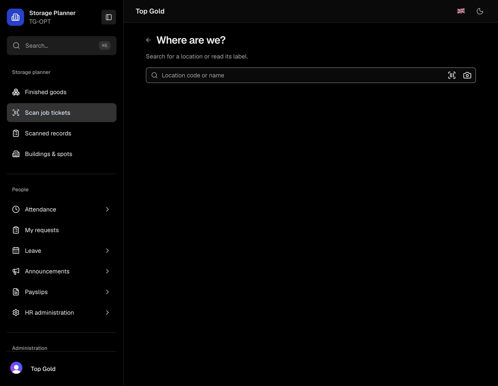
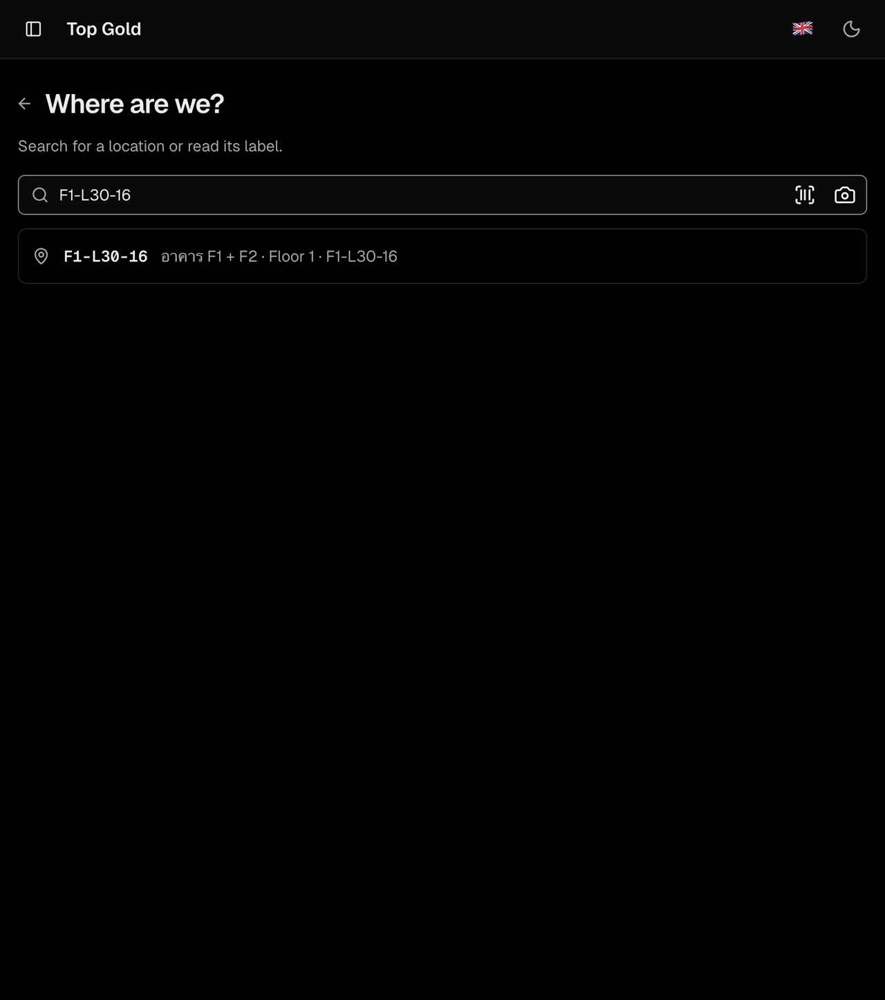

# Filter/search/pagination research evidence

The [implementation plan](../../plans/filter-search-pagination-performance-2026-10-12.md) consolidates this evidence. Research started October 12 and concluded October 13, 2026 (Asia/Bangkok). Application code and deployment were not changed.

- [Location diagnosis, reproduction commands, and test results](location-tests.md).
- [App-wide surface inventory](surface-inventory.md).
- [Verified framework constraints and proposed search design](framework-research.md).
- [Independent Kiro review](kiro-review.md).
- [Original worktree base](baseline-commit.txt); the original dirty-workspace snapshot remains in the separate research worktree.

## Historical snapshot

This evidence describes the research snapshot at `733c6aca` plus pre-existing local changes. The implementation starts from clean upstream `11c8c2cc`, which contains the deployed blank-search gate and newer HR/AI usage pages. See the [delivery coverage audit](../filter-delivery-2026-10-13/sol-coverage.md) for the reconciled scope. Research probes and their configuration are archived here with `.txt` suffixes; run the original filenames in the preserved research worktree to reproduce the historical baseline. They are not current application tests.

## Live browser observations

Authenticated T3 preview, `https://app.thaipropertyai.com/en/finished-goods/scan`, warehouse TG-OPT. Only reads/search changes were performed. No locations or scan records were created, modified, or deleted.

The timing probe attached an `input` event listener and a `MutationObserver` to the main content. `performance.now()` timestamps measured input-to-DOM-result, excluding tool-call round-trip time. The exact result marker was the known location's building text accompanying `F1-L30-16`; the generic `li` count alone is not a match count because empty-state and save-for-later rows can also be list items. The page was reloaded afterward to remove instrumentation, and the original exact search was restored.

| Scenario                 | Observed outcome                                                                                             | Trace                                                                                 |
| ------------------------ | ------------------------------------------------------------------------------------------------------------ | ------------------------------------------------------------------------------------- |
| Exact `F1-L30-16`, run 1 | 14,115 ms to matching location                                                                               | [JSON](live-exact-trace.json)                                                         |
| Exact `F1-L30-16`, run 2 | 13,795 ms to matching location                                                                               | [JSON](live-exact-repeat.json)                                                        |
| Empty search             | 0 selectable location buttons after 43,024 ms; no loading message                                            | [JSON](live-blank-trace.json)                                                         |
| Prefix `F1-L30`          | No matching location displayed by 23,932 ms; exact-code-missing/create UI appears while search is unfinished | [Initial events](live-prefix-initial.json), [last 100 events](live-prefix-trace.json) |

The first exact trace retains up to 70 most recent events; its separately computed `timeToResultMs` used the full captured event list. The repeat retains the first and last four events, including input and result. The prefix's start event is at 618,893 ms in the initial file and its later observation is at 642,825 ms in the later file. The initial blank file is a separate shorter observation, not the 43-second check.





### Why production blank search stays blank

[Captured snippets](deployed-picker-snippets.json) came from same-origin public JavaScript URLs already loaded in the page. The relevant chunk is `/_next/static/immutable/chunks/3stz5_2p4j0ur.js`:

```js
browseWithoutSearch: N = !1;
Q = N || !!K.trim();
useQuery(searchJobScanLocations, Q ? {/* current criteria */} : "skip");
```

The exact gate is present in deployed code and absent from the current source snapshot. The live blank observation agrees with the gate; local tests correctly show that the current source requests and displays a ready blank page. The production backend revision and production dataset size were not inspected.

### Limits

Two exact-search observations are not p95, not a controlled cold/warm comparison, and not a device/network matrix. No database server-duration trace was captured. Local fixture operation counts establish a current-source amplification mechanism; they do not count the live page's WebSocket requests or predict hosted database billing. No before/after improvement is claimed because this task produces a plan.

## Reproducible tests

Run commands in `/Users/macbook/Development/industrial-sas-filter-research`. The `.probe.test.ts(x)` files are intentionally under this evidence directory and use `vitest.research.config.mts`; normal Vitest discovery does not pick them up. Four acceptance checks are expected to fail until the planned behavior is implemented. Seven other probe checks pass.

Existing targeted test batches passed (53 location-related checks, 56 broader pagination/storage checks, and 18 HR/cursor checks). These batches overlap; do not add them as a unique test total. Logs and per-batch commands are in the individual reports and `existing-pagination-tests.txt`.

Kiro's independent synthetic scaling measurements and their limitations are documented in its review. Keep research-only temporary harnesses out of ordinary application test discovery before handing off implementation.

Final TypeScript check: `pnpm exec tsc --noEmit --incremental false` passed with no diagnostics after removal of Kiro's disposable integration test. The research probes remain reproducible under their separate Vitest configuration. Product-source diffs still match the original workspace snapshot.

## Reconciliation of the independent review

Kiro's additional baseline batch passed 74 tests across 7 files, overlapping the other batches. Its 100/1,000-row measurements are retained as [JSON](kiro-measure-100.json) and [JSON](kiro-measure-1000.json). Its temporary harness was removed as described in the appendix; the separate 121-row location probes remain runnable.

The consolidated plan takes precedence where independent recommendations differ:

- Kiro did not inspect the live browser. Its blank-list explanations are current-source possibilities; the deployed query-skip gate is the directly evidenced cause of this live blank search. Its request-RTT estimates are not additional measured production timings.
- The measured operation counts show a sequential-scan bottleneck; they do not establish that individual hosted queries are fast or that the database has no other costs.
- Increasing scan chunks may be a useful interim optimization, but it does not replace indexed filtering or immediate exact results. Carrying extra matches requires its own cursor-size, live-update and no-skipped-row tests; do not simply relax cursor bounds.
- The requested building filter is part of the early location slice, not optional. Its API and indexed scope ship together.
- The more detailed inventory distinguishes record lists from bounded calendars/editors. HR history and holiday calendars do not need arbitrary row pages inside a month/year; their queries still need bounded efficient reads. HR requests already paginate and have a maximum page size of 50.
- An exclusion count must not require scanning every inaccessible/ineligible row before showing a list. Keep clear eligibility guidance without adding an expensive total or exposing unauthorized records.
