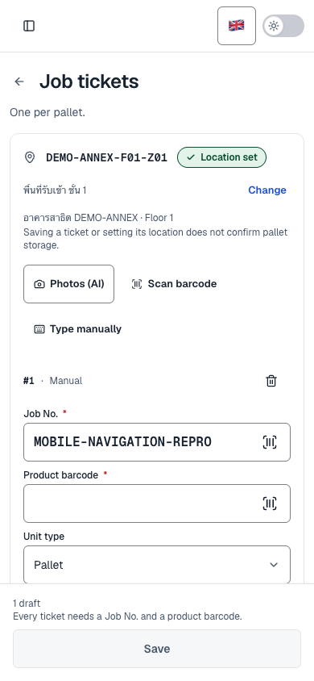

# Navigation bugs, with focus on scan

The reported scan navigation failures were reproduced and fixed in the workspace. Existing unrelated changes were preserved.

## Confirmed defects and fixes

1. **Selecting the active scan menu erased Back history.** Open Finished goods → Scan job tickets → select Scan job tickets again → Back. Next replaces its history state during a same-URL refresh without changing pathname/search. The old pathname-based bookkeeping never restored `appNavigationIndex`, so Back incorrectly used the parent fallback. History depth is now stamped on actual history writes, including same-URL refreshes and hash-only navigation.
2. **The same refresh broke dirty-ticket Back/Discard.** Add a manual ticket, select the active scan menu, then Back → Discard changes. Next also erased the draft buffer marker, so the guard waited for a restoration that it could never recognize. Same-entry replacements now retain the draft and catalogue metadata while accepting Next's new router tree. The guard buffer does not count as an app navigation step.
3. **A redirected history destination could leave the loading screen active.** The progress provider expected the original history pathname even after a different canonical route committed. It now clears the pending destination on the committed route and lets a newer navigation supersede it. Earlier pending improvements already present in the working tree were retained.
4. **An unchanged query could add a useless Back step.** `updateBrowserQuery` previously pushed even when its resulting URL was identical. It now replaces metadata for an unchanged URL.
5. **Nine main HR pages suppressed Back.** Today, attendance history, requests, holidays, profile, review, employees, periods, and settings now use the shared Back control, including while data loads. Sign-in keeps its existing behavior.
6. **Skip-to-content could create a history entry Next could not restore.** A native fragment entry has no Next router state. After navigating away, Back could leave the global loader waiting for a route that Next ignores. The skip link now focuses main without changing history, and the progress provider does not wait on unmanaged history entries.
7. **Query-only record selection hid the entire page.** The locale router used the shell's full-page loading cover for every push/replace, including a new query on the current page. Programmatic navigation and links now reserve that cover for pathname changes; record selection keeps the current UI visible during Next's own transition. Locale changes still show route progress.

## Verification

- Before fixing, the new navigation tests failed for lost Back history, hash history, duplicate query entries, and redirected loading. The dirty-page Back/Discard regression also failed; all nine HR navigation checks failed because their Back controls were absent.
- Final combined checks: **89 files, 924 tests passed**, with two workers. Includes HR, storage, finished goods, hooks, navigation progress, draft guards, query history, locale-switcher, and sidebar. Regression tests exercise real jsdom Back/Forward for the dirty-page refresh case, plus Strict Mode cleanup. The combined run overlapped with a production build once and produced timeout failures; rerunning with two workers after the build completed passed every case.
- Typecheck, scoped ESLint with zero warnings, scoped Prettier, `git diff --check`, and the production webpack build passed.
- Real authenticated local production browser checks passed: five active-scan-menu/Back cycles; browser Back/Keep editing preserves a ticket draft; in-app Back/Discard returns to Finished goods; the same draft decisions work at a 390 × 844 mobile viewport; HR Profile Back returns to the previous page. No uncaught browser errors. No tickets were submitted. The skip-link/Back scenario also passed. Query-only employee selection kept the page visible while its RSC response was deliberately delayed by 800 ms.
- Mechanical UI detector returned no findings.
- The local Convex backend on port 3211 stopped during verification. Restarting the same anonymous deployment restored the existing data and allowed the final production browser checks to complete.

Production browser evidence is in [browser-checks.json](browser-checks.json). 15 scan navigation measurements ranged from **32–605 ms**, with a median of **65 ms**. These measure navigation to the visible page shell in a local production build with a local backend. They exclude OCR/AI work and are not a measurement of the deployed service. The first development route loads observed before the fix took roughly 2–6 seconds; development compilation and the incorrect parent fallback were separate contributors. The specific ten-second deployed case has not been timed.

Mobile scan after choosing Keep editing:



## Checks to rerun

```sh
pnpm exec vitest run src/features/hr src/features/storageLayouts src/features/finishedGoods src/hooks src/components/system src/components/providers/DraftGuardProvider.test.tsx src/components/ui/PageBackButton.test.tsx src/lib/browser/history.test.ts src/components/shell/LocaleSwitcher.test.tsx src/components/shell/SidebarNavigationLink.test.tsx src/components/examples/c-sidebar-2.test.tsx --maxWorkers 2
pnpm typecheck
NEXT_DIST_DIR=.cache/navigation-audit/next-build pnpm exec next build --webpack
```

Kiro was run with `claude-opus-5.5`, high effort, in a read-only audit. It independently investigated the same-URL guard/history failures using temporary harnesses and compared the committed implementation with snapshots of the working tree. Its [audit](kiro-audit.md) identified the skip-link and query-navigation failures as still present in its snapshot; both were fixed afterward and covered with additional regression tests. Uncertain leads, including a possible save/navigation race modelled only in jsdom, remain separate from the confirmed defects.
