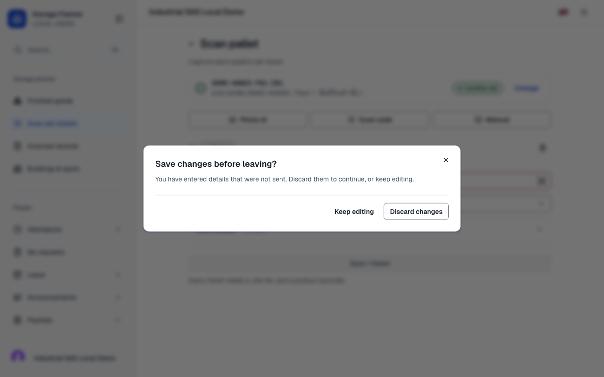
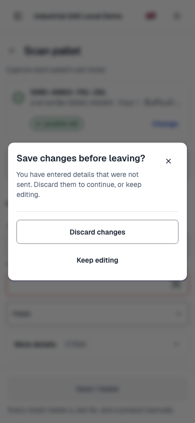
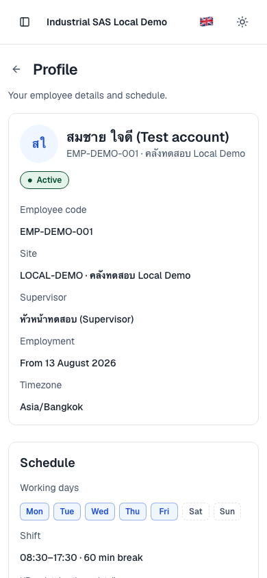

# Shared navigation and workflow delivery

This change gives draft navigation, committed URL reads and asynchronous write completion shared ownership. It restores HR Back controls and fixes failures reproduced through the production hooks and providers. The original working directory was left untouched; implementation and rebase were performed in a separate worktree.

## Review and division of work

Kiro using Claude Opus 5.5 reviewed the [plan](../../plans/shared-core-navigation-2026-10-12.md), requested six revisions and then [accepted revision 2](kiro-plan-acceptance.md). Kiro implemented most frontend changes, integrated the shared hooks into screens and reconciled the main-branch navigation, sidebar, storage and camera changes. Codex implemented the URL/write primitives, audited backend boundaries and verified integration. GPT-6.1-Sol independently reproduced frontend failures and audited the final resolutions.

The branch was rebased onto `ed01d47f8dcccdd7c53af6fb2ac0e9c24ba7b331`, preserving the sidebar/camera work from PR #81 and navigation/loading/storage changes from PR #83.

## Problems and fixes

| Reproduced problem                                                                                                                                                   | Shared behavior after the change                                                                                                                                                | Regression evidence                                                                      |
| -------------------------------------------------------------------------------------------------------------------------------------------------------------------- | ------------------------------------------------------------------------------------------------------------------------------------------------------------------------------- | ---------------------------------------------------------------------------------------- |
| Same-entry Next replacement lost application depth and draft markers. Captured history wrappers could remain active after cleanup.                                   | The shell tracker preserves application metadata while accepting the current Next router state; detached captured wrappers pass through.                                        | `NavigationProgress.test.tsx`, `NavigationGuardProvider.test.tsx`                        |
| Multiple guard owners, pending saves and asynchronous buffer cleanup disagreed about whether navigation could proceed.                                               | One shell owner coordinates browser listeners, prompt, draft registrations and ordered `settle` completion. Pending work locks leaving; failed saves retain the draft.          | Provider, Scan and period-create guard tests                                             |
| Browser history-menu destinations collapsed to a single Back. Keep editing and repeated traversal could choose the wrong page.                                       | The owner retains the selected committed destination and restores the editor before prompting. Discard then reaches that exact destination.                                     | Provider and `useBrowserQuery.guard.test.tsx`; authenticated Chromium history-menu check |
| Remount/reload guard buffers introduced duplicate Back steps, including at depth zero. Changing Map/List before a clean reload also left an invisible old-view step. | Existing owned buffers are reused. Clean mount performs no traversal; the first requested Back skips only the internal base entry.                                              | Actual-provider reload tests using the real floor view setter; browser Scan reload check |
| Catalogue preferences leaked across scopes; independent query readers could publish intermediate guard traversal URLs.                                               | A typed catalogue hook owns scoped fallback and history grouping. One committed-query subscription freezes internal traversal and publishes the final URL.                      | Both catalogue suites, real hydration test and workspace/query guard tests               |
| Late finished-goods or HR/clock results affected a newer workflow or removed its retry identity. A late Packing refusal could replace quantity 200 with 100.         | Shared lifecycle tickets suppress stale success/error effects. Current-only callbacks own UI/draft changes; domain retry identities and exact uncertain payloads remain intact. | Async-operation, HR write, Packing and AddLocation tests                                 |
| HR feature headers hid Back; a direct-open fallback could send an HR-only user to an inaccessible planner page.                                                      | Existing PageHeader/Back controls use an authorized HR parent or visible alternative after access loads.                                                                        | `HrBack.test.tsx`; authenticated desktop/mobile Profile → My day                         |

PR #83 already contains the main loading-cover fixes. This branch preserves those fixes, adds captured-wrapper coverage and corrects classification of localized object links with an omitted pathname. It does not claim those upstream fixes as new implementation.

## Code that now has one owner

| Seam                | Owners and boundary                                                                                                                                                                                                   |
| ------------------- | --------------------------------------------------------------------------------------------------------------------------------------------------------------------------------------------------------------------- |
| Draft navigation    | `NavigationGuardProvider` and `useNavigationDraft` own one prompt/buffer/listener set. Storage and HR adapters register entries; JobScan adopts this guard. The deleted storage hook no longer owns a separate guard. |
| Committed URL state | `appHistory`, the committed browser subscription and `useCatalogueUrlState` own history mechanics, scoped fallback and typing groups. Feature codecs retain their validation/defaults/storage formats.                |
| Write lifecycle     | Private `useOperationLifecycle` and request-identity storage serve the existing finished-goods and HR adapters. Domain envelopes, refusal handling and uncertain retry rules stay with their callers.                 |
| Screen completion   | Existing async-operation callbacks apply effects only to the current workflow. StorageZones create/update use one completion path; existing PageHeader, Back and OutcomeGate controls are reused.                     |

Other finished-goods editors retain their established leave dialogs; their write-completion effects use the shared lifecycle. There are no backend/schema/dependency/runtime changes. The [backend audit](codex-backend-audit.md) found no reason to rewrite the existing tenant/envelope/idempotency seams.

## Verification

Full local verification passed: all seven Vitest projects (300 files, 3,879 tests), pinned Bun 1.4.3 / TypeScript 7.0.2 type checking, lint, formatting, test discovery, app/release audits and production dependency audit. The pinned-Bun production webpack build passed, including TypeScript and all 70 static pages. The final source passed the full suite again after the additional floor-view reload regression; GitHub required-check results are recorded in the PR.

The bounded Impeccable detector returned no findings on the changed UI targets. Desktop (1280×800) and mobile (390×844) inspection confirmed visible Back controls, usable draft prompts and no mobile horizontal overflow. The final [Kiro reload fix](kiro-reload-fix.md) resolves the independently reproduced [Sol finding](sol-reload-finding.md). Independent [URL](codex-url-audit.md), [write](codex-write-audit.md) and [Sol](sol-final-audit.md) reports retain their source-snapshot boundaries; historical intermediate reports are not substitutes for the final checks.

### Authenticated production-browser evidence

Chromium ran against a pinned-Bun production build with test Clerk credentials and an isolated local Convex backend seeded with synthetic data. No production writes were made. The T3 preview reported `PreviewAutomationNoAvailableHostError`; the standalone browser supplied these checks and screenshots after that unavailable-host result.

| Actual browser scenario                                              | Result                                                                                    |
| -------------------------------------------------------------------- | ----------------------------------------------------------------------------------------- |
| Three Scan → Finished goods → Records → native Back cycles           | 12 successful transitions; first Scan 818 ms, remaining shell transitions 10–61 ms        |
| Dirty Scan → native Back → Keep editing                              | Ticket value retained                                                                     |
| Farther native history jump → Keep → Forward → repeat jump → Discard | Forward did not prompt; Discard reached the selected Records entry and its original depth |
| Dirty Scan → accepted reload → first native Back                     | Reached Records on the first requested Back                                               |
| Save a synthetic manual ticket → Records → native Back               | Saved ticket appeared in Records; Back returned to clean Scan without a draft prompt      |
| Direct-open HR Profile → in-page Back, desktop and mobile            | Reached authorized My day                                                                 |
| Mobile dirty Scan → in-page Back → Keep                              | Ticket retained; no horizontal overflow                                                   |

Timings measure local navigation until the main heading becomes visible, as recorded in [transitions.json](transitions.json). They exclude OCR, backend completion and deployed network latency, and do not establish that the reported ten-second production symptom is eliminated under every production condition. Account-scope races are covered by hook regression tests rather than a live multi-account browser switch. Physical camera hardware was not tested.

