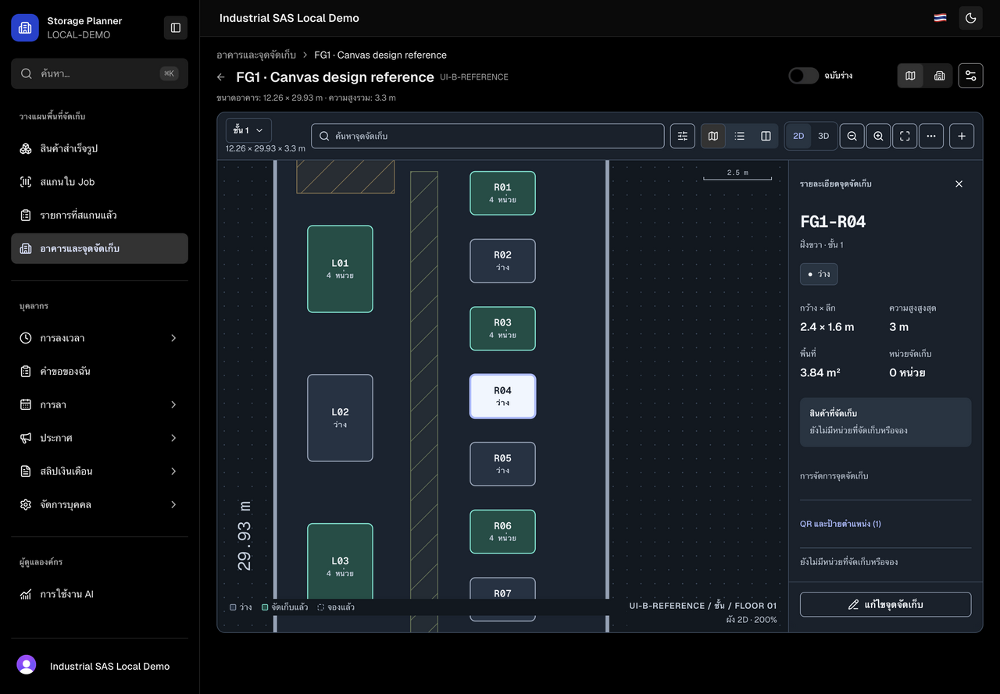
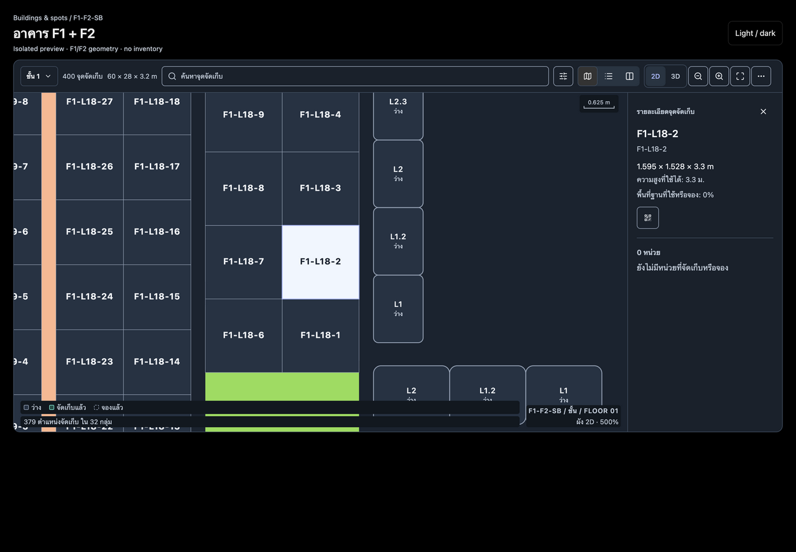

# Screenshot gallery — 2026-10-12

All PNGs are unedited T3 browser captures. Final pages use the local production build on main `4850de86` plus this fix, with synthetic inventory. F1/F2 uses the real FloorMap component with saved geometry and no inventory. These are not screenshots of a deployed release.

48 final combinations cover six surfaces, Thai/English, dark/light, desktop 1440 × 1000 and mobile 390 × 844 CSS pixels. Native output can be scaled to the T3 preview surface. Mobile checks emulate a viewport; physical touch and camera hardware were not tested.

## Key fixes

| Before                                                                         | After                                                                                         |
| ------------------------------------------------------------------------------ | --------------------------------------------------------------------------------------------- |
| [Two menu triggers](screenshots/before/fg1-more-th-desktop.png)                | [Display menu and direct Plus action](screenshots/after/fg1-display-menu-th-dark-desktop.png) |
| [Duplicate inspector headers](screenshots/before/fg1-inspector-th-desktop.png) | [Single inspector header at 200%](screenshots/after/fg1-inspector-200-th-dark-desktop.png)    |
| [FG1 labels](screenshots/before/fg1-th-desktop.png)                            | [FG1 at 500%](screenshots/after/fg1-500-th-dark-desktop.png)                                  |
| [F1/F2 floor 1 reference](screenshots/before/f1-f2-floor1-th-dark-mobile.png)  | [F1/F2 selected location at 500%](screenshots/after/f1-f2-inspector-500-th-dark-desktop.png)  |

## Complete final matrix

| Surface / locale    | Dark desktop                                                | Light desktop                                                | Dark mobile                                                | Light mobile                                                |
| ------------------- | ----------------------------------------------------------- | ------------------------------------------------------------ | ---------------------------------------------------------- | ----------------------------------------------------------- |
| finished-goods / TH | [PNG](screenshots/after/finished-goods-th-dark-desktop.png) | [PNG](screenshots/after/finished-goods-th-light-desktop.png) | [PNG](screenshots/after/finished-goods-th-dark-mobile.png) | [PNG](screenshots/after/finished-goods-th-light-mobile.png) |
| finished-goods / EN | [PNG](screenshots/after/finished-goods-en-dark-desktop.png) | [PNG](screenshots/after/finished-goods-en-light-desktop.png) | [PNG](screenshots/after/finished-goods-en-dark-mobile.png) | [PNG](screenshots/after/finished-goods-en-light-mobile.png) |
| scan / TH           | [PNG](screenshots/after/scan-th-dark-desktop.png)           | [PNG](screenshots/after/scan-th-light-desktop.png)           | [PNG](screenshots/after/scan-th-dark-mobile.png)           | [PNG](screenshots/after/scan-th-light-mobile.png)           |
| scan / EN           | [PNG](screenshots/after/scan-en-dark-desktop.png)           | [PNG](screenshots/after/scan-en-light-desktop.png)           | [PNG](screenshots/after/scan-en-dark-mobile.png)           | [PNG](screenshots/after/scan-en-light-mobile.png)           |
| records / TH        | [PNG](screenshots/after/records-th-dark-desktop.png)        | [PNG](screenshots/after/records-th-light-desktop.png)        | [PNG](screenshots/after/records-th-dark-mobile.png)        | [PNG](screenshots/after/records-th-light-mobile.png)        |
| records / EN        | [PNG](screenshots/after/records-en-dark-desktop.png)        | [PNG](screenshots/after/records-en-light-desktop.png)        | [PNG](screenshots/after/records-en-dark-mobile.png)        | [PNG](screenshots/after/records-en-light-mobile.png)        |
| buildings / TH      | [PNG](screenshots/after/buildings-th-dark-desktop.png)      | [PNG](screenshots/after/buildings-th-light-desktop.png)      | [PNG](screenshots/after/buildings-th-dark-mobile.png)      | [PNG](screenshots/after/buildings-th-light-mobile.png)      |
| buildings / EN      | [PNG](screenshots/after/buildings-en-dark-desktop.png)      | [PNG](screenshots/after/buildings-en-light-desktop.png)      | [PNG](screenshots/after/buildings-en-dark-mobile.png)      | [PNG](screenshots/after/buildings-en-light-mobile.png)      |
| fg1 / TH            | [PNG](screenshots/after/fg1-th-dark-desktop.png)            | [PNG](screenshots/after/fg1-th-light-desktop.png)            | [PNG](screenshots/after/fg1-th-dark-mobile.png)            | [PNG](screenshots/after/fg1-th-light-mobile.png)            |
| fg1 / EN            | [PNG](screenshots/after/fg1-en-dark-desktop.png)            | [PNG](screenshots/after/fg1-en-light-desktop.png)            | [PNG](screenshots/after/fg1-en-dark-mobile.png)            | [PNG](screenshots/after/fg1-en-light-mobile.png)            |
| f1-f2 / TH          | [PNG](screenshots/after/f1-f2-th-dark-desktop.png)          | [PNG](screenshots/after/f1-f2-th-light-desktop.png)          | [PNG](screenshots/after/f1-f2-th-dark-mobile.png)          | [PNG](screenshots/after/f1-f2-th-light-mobile.png)          |
| f1-f2 / EN          | [PNG](screenshots/after/f1-f2-en-dark-desktop.png)          | [PNG](screenshots/after/f1-f2-en-light-desktop.png)          | [PNG](screenshots/after/f1-f2-en-dark-mobile.png)          | [PNG](screenshots/after/f1-f2-en-light-mobile.png)          |

## Interaction states

| State                               | Screenshot                                                       |
| ----------------------------------- | ---------------------------------------------------------------- |
| fg1-inspector-200-th-light-desktop  | [PNG](screenshots/after/fg1-inspector-200-th-light-desktop.png)  |
| fg1-display-menu-th-light-desktop   | [PNG](screenshots/after/fg1-display-menu-th-light-desktop.png)   |
| fg1-inspector-200-th-dark-desktop   | [PNG](screenshots/after/fg1-inspector-200-th-dark-desktop.png)   |
| fg1-display-menu-th-dark-desktop    | [PNG](screenshots/after/fg1-display-menu-th-dark-desktop.png)    |
| fg1-500-th-dark-desktop             | [PNG](screenshots/after/fg1-500-th-dark-desktop.png)             |
| fg1-table-th-dark-desktop           | [PNG](screenshots/after/fg1-table-th-dark-desktop.png)           |
| fg1-split-th-dark-desktop           | [PNG](screenshots/after/fg1-split-th-dark-desktop.png)           |
| fg1-inspector-th-dark-mobile        | [PNG](screenshots/after/fg1-inspector-th-dark-mobile.png)        |
| scan-search-th-dark-mobile          | [PNG](screenshots/after/scan-search-th-dark-mobile.png)          |
| f1-f2-500-th-dark-desktop           | [PNG](screenshots/after/f1-f2-500-th-dark-desktop.png)           |
| scan-return-en-dark-desktop         | [PNG](screenshots/after/scan-return-en-dark-desktop.png)         |
| scan-location-chosen-th-dark-mobile | [PNG](screenshots/after/scan-location-chosen-th-dark-mobile.png) |
| scan-manual-th-dark-mobile          | [PNG](screenshots/after/scan-manual-th-dark-mobile.png)          |
| f1-f2-inspector-500-th-dark-desktop | [PNG](screenshots/after/f1-f2-inspector-500-th-dark-desktop.png) |

## Baseline captures

Baseline captures use `a050a851`. Scan and sidebar also incorporate upstream PR #81 in the final images. Initial F1/F2 captures show Floor 2; the additional `floor1` file is the user's floor reference. Fully loaded captures replaced early skeleton captures before this gallery was finalized.

| State                          | Screenshot                                                   |
| ------------------------------ | ------------------------------------------------------------ |
| scan-en-desktop                | [PNG](screenshots/before/scan-en-desktop.png)                |
| fg1-th-desktop                 | [PNG](screenshots/before/fg1-th-desktop.png)                 |
| fg1-inspector-th-desktop       | [PNG](screenshots/before/fg1-inspector-th-desktop.png)       |
| fg1-more-th-desktop            | [PNG](screenshots/before/fg1-more-th-desktop.png)            |
| finished-goods-th-dark-desktop | [PNG](screenshots/before/finished-goods-th-dark-desktop.png) |
| scan-th-dark-desktop           | [PNG](screenshots/before/scan-th-dark-desktop.png)           |
| records-th-dark-desktop        | [PNG](screenshots/before/records-th-dark-desktop.png)        |
| buildings-th-dark-desktop      | [PNG](screenshots/before/buildings-th-dark-desktop.png)      |
| fg1-th-dark-desktop            | [PNG](screenshots/before/fg1-th-dark-desktop.png)            |
| f1-f2-th-dark-desktop          | [PNG](screenshots/before/f1-f2-th-dark-desktop.png)          |
| finished-goods-th-dark-mobile  | [PNG](screenshots/before/finished-goods-th-dark-mobile.png)  |
| scan-th-dark-mobile            | [PNG](screenshots/before/scan-th-dark-mobile.png)            |
| records-th-dark-mobile         | [PNG](screenshots/before/records-th-dark-mobile.png)         |
| buildings-th-dark-mobile       | [PNG](screenshots/before/buildings-th-dark-mobile.png)       |
| fg1-th-dark-mobile             | [PNG](screenshots/before/fg1-th-dark-mobile.png)             |
| f1-f2-th-dark-mobile           | [PNG](screenshots/before/f1-f2-th-dark-mobile.png)           |
| f1-f2-floor1-th-dark-mobile    | [PNG](screenshots/before/f1-f2-floor1-th-dark-mobile.png)    |
