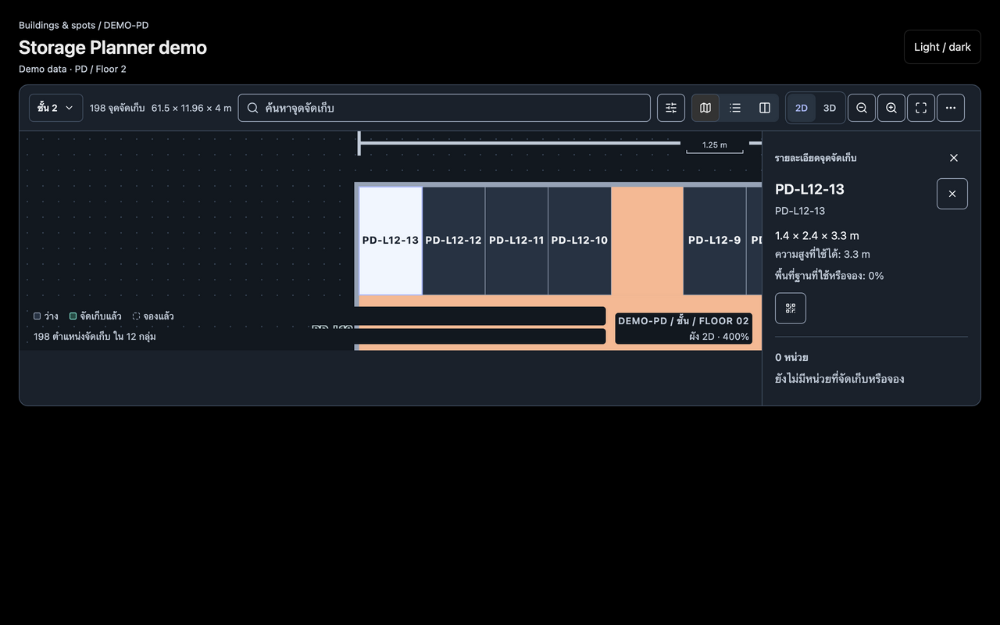
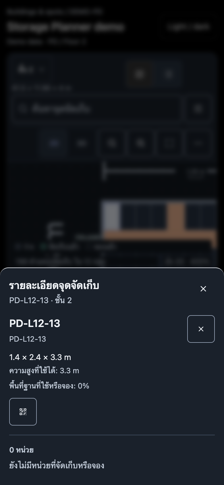

# Browser verification — 14 October 2026

Used the T3 collaborative browser with the existing `scripts/storage-workspace-preview` Vite harness. It renders the current production `FloorMap`, translations and CSS with isolated fixture data. This is not an authenticated production or local-backend session.

## Repeated location identity, confirmed visually

1. Start `pnpm exec vite --config scripts/storage-workspace-preview/vite.config.mjs --host 127.0.0.1 --port 3190 --strictPort`.
2. Open `http://localhost:3190/?locale=th&fixture=empty`.
3. Select the location `PD-L12-13`.
4. At desktop width, the inspector renders `PD-L12-13` twice consecutively: the location label and code have the same value.
5. At 390 × 844 CSS pixels, open the same location. The mobile sheet renders `PD-L12-13` three times: in the sheet description, as the location heading and again as the code below it.

Source: `src/components/storageLayouts/FloorMap.tsx:427` (label), `:430` (code), and `:1042` (mobile sheet description). This fallback inspector is used by the application demo route under `/[locale]/master-data/storage-layouts/demo`; the preview uses the same component path.

The main building workspace supplies `StorageZonesPanel` as a custom inspector, so the screenshots do not establish its entire content. Its analogous repeated identity and repeated empty-inventory text are separately source-traced and covered by Kiro's component probes. Do not mistake the fixture header's English explanatory text for an application translation defect.

The mobile page remained within its viewport (`scrollWidth === innerWidth === 390`). This verifies emulated responsive layout, not physical-device touch behavior.

Machine-readable observation: [browser-checks.json](evidence/browser-checks.json).

## Existing tests and detector

- `pnpm exec vitest run --project a11y`: **20 tests passed, 5 files**, 3.85 seconds.
- `pnpm exec vitest run --maxWorkers=3`: **3,315 tests passed, 282 files**, 127.18 seconds. This includes the accessibility project; the two counts are not additive.
- Impeccable's detector was run once across the HR, finished goods, storage and shell source directories. Its three findings were confined to `_prototype` assets: two font-preference warnings and one small prototype label. None establishes a production bug; all were excluded from the issue list.

Logs are in `evidence/a11y-tests.log`, `evidence/full-vitest.log` and `evidence/impeccable-detector.json`. Passing existing tests does not negate the separately reproduced audit findings. No application code or existing tests were edited for this browser verification.
